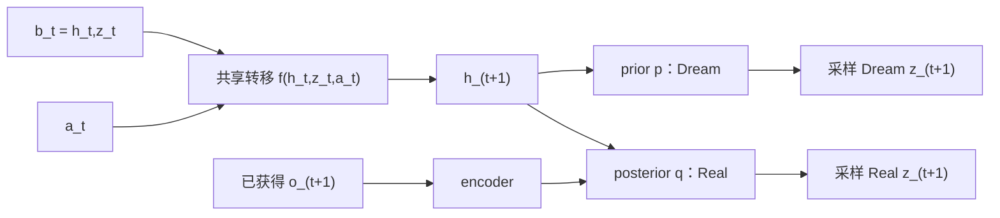
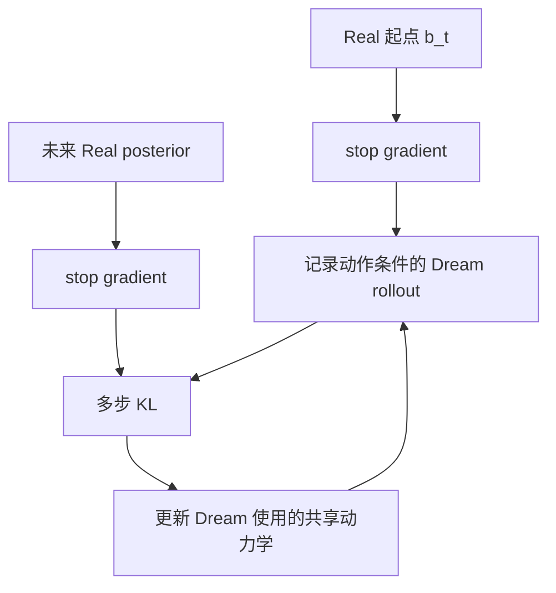
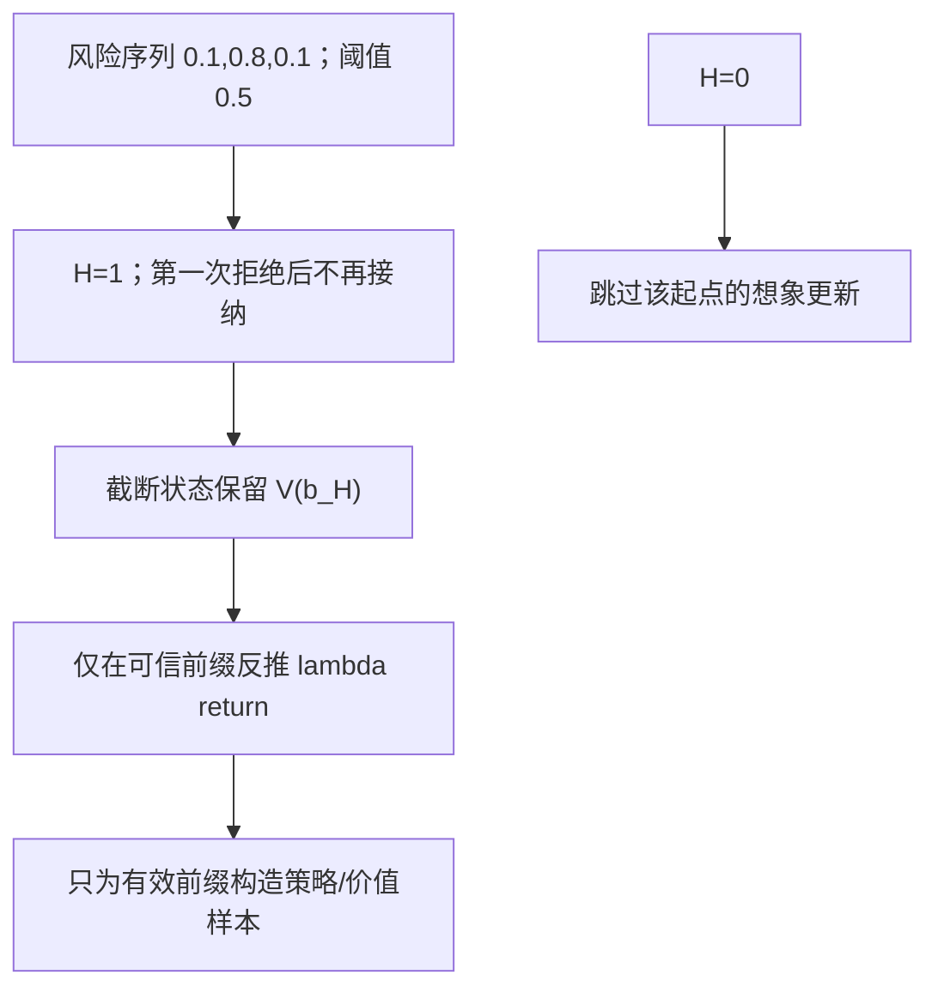

# HelixWM v0.1：从原理到可检查的代码

## 研究问题

模型 ensemble 可以因为相同的数据缺口或表示偏差而一致犯错。HelixWM 的核心假设是：**已经发生的真实预测误差，能否在 ensemble 分歧之外，帮助判断接下来哪些想象片段值得用于策略学习？**

这个问题包含三个独立部分：修正预测模型、估计预测风险、控制预测的使用范围。它们需要独立消融，不能仅凭组合结构宣称创新或性能提升。

## v0.1 的边界

这是与 [README](../README.md) 公式对应的 PyTorch 参考实现。小型向量编码器便于检查因果性、梯度和数值计算；不是 DreamerV3 作者代码的复现，也不是已接入像素 Walker 的完整训练程序。

正式环境仍以 DMC Walker Walk 的像素连续控制为候选。这里的合成输入只做程序验证，不产生实验回报、学习曲线或论文结果。

首版选用共享 RSSM。独立的 Real/Dream 动力学是原构想中的可选结构，后续可以比较；Real 是观测条件下的估计，而不是物理真值。

## 时间索引与数据接口

| 张量 | 形状 | 含义 |
|---|---|---|
| observations | B × (T+1) × O | 从 o_0 到 o_T |
| actions | B × T × A | a_t 导致下一观测 o_(t+1) |
| rewards / continuations | B × (T+1) | r_i、c_i 对齐 o_i；第 0 项不训练 transition 预测头 |
| is_first | B × (T+1) | 当前观测是否新 episode 的第一帧 |
| valid | B × (T+1) | 观测是否有效；不是 episode 终止标记 |
| posterior / prior logits | B × (T+1) × J × C | 分组 categorical 潜变量 |

reset 位置必须清除上一回合状态与动作的影响。多步校正要求从起点到终点全部有效，且中间没有 reset。校正不跨 episode，即使两端都有有效观测。

Dream 的函数输入没有未来观测参数。共享参数并不意味着两条轨迹相同：Real 每步吸收观测，Dream 依赖自己预测的状态递推。

## 基础学习与多步校正

参考预测头使用固定单位方差的 Gaussian 观测/奖励损失（省略常数）以及 Bernoulli continuation 损失。分组 latent 的 KL 对所有组求和。基础损失保留 dynamics/representation 两条 KL 梯度路径。

多步校正从 k=2 开始：

$$
L_{cc}=\frac{\sum_{t,k\ge2}m_{t,k}w_k\,\mathbb E_{roll}
 D_{KL}(\operatorname{sg}(q^R_{t+k})\Vert p^D_{t,k})}
 {\sum_{t,k\ge2}m_{t,k}w_k+\epsilon}.
$$

v0.1 默认 w_k=1，用一次随机 rollout 近似期望。起点、教师 posterior 都 detach；共享动力学仍通过 Dream 路径获得梯度。straight-through categorical 采样提供近似梯度，不宣称是精确无偏梯度。

此处梯度隔离是该辅助损失的局部计算性质。基础模型损失仍需训练 encoder；更新共享动力学也会改变之后 Real 路径的上下文。

## 可靠性：输入与标签必须分开

1. 预测在看到结果前保存，之后才能计算观测到的误差历史。
2. ensemble 成员独立初始化，用各自 bootstrap 掩码监督；同一模型多次采样不等于模型 ensemble。
3. risk head 的第 k 项只读取当前 belief、已发生的误差历史以及前 k 个候选动作/分歧。
4. 真实未来奖励仅用于构建训练标签：

$$
Y_{t,k}=\mathbf1\left[\max_{1\le j\le k}
 |r_{t+j}-\hat r_{t,j}|/s_r>\varepsilon_{task}\right].
$$

这里的累计事件指“此前曾超过阈值”，不是把误差相加。没有实际未来标签的样本必须屏蔽；不能用零标签表示未知。

多个 categorical 预测成员的 mixture JS 对成员和 latent 组求平均；它是分歧代理，不是错误概率。训练 BCE 也不保证风险头已校准，后续需要独立 episode 划分的校准集和测试集。

## 门控与价值目标

取最长连续可信前缀 H，第一步就不可信时 H=0。v0.1 在固定长度数组上计算，不能据此声称减少 rollout 生成成本。

若两步奖励都是 1，gamma=0.99，lambda=1，末端 V=10：

$$G_1=1+0.99(10)=10.9,\quad G_0=1+0.99(10.9)=11.791.$$

截断不等于环境终止。拒绝的尾部不参与前缀 return 递推；真实 continuation=0 才清除该 transition 的后续价值。

## 暂缓实现的部分

- 完整 actor/critic 优化和 replay/environment 循环、像素 CNN、checkpoint 及训练恢复。
- 作者 DreamerV3 固定版本的适配、与开关关闭路径的一致性检查。
- 受限的 context residual：`F_base(c,a) + DeltaF(c,a,xi)`，需处理分解不可辨识性。
- 主动采样：综合任务价值、信息增益、可达性与真实交互成本。

这些项目仍属于研究设计，当前模块测试通过也不能代替正式训练验收。
