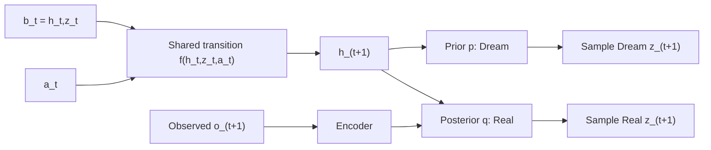
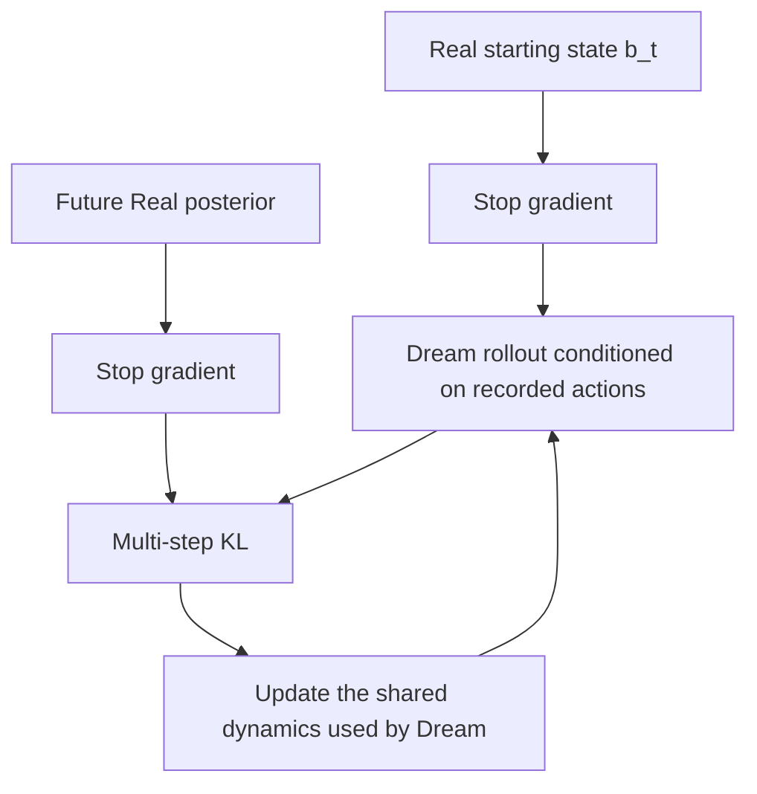
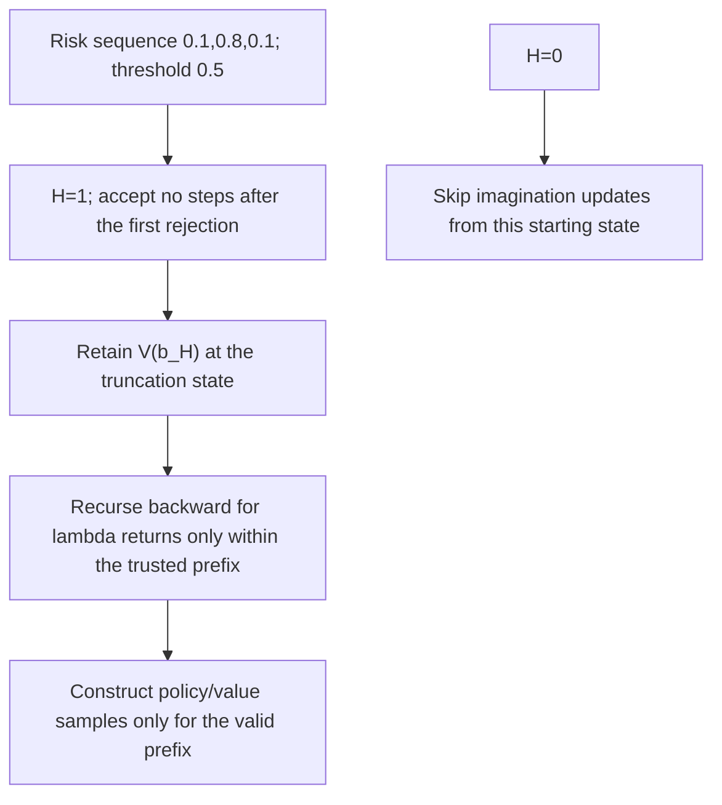

# HelixWM v0.1: From Principles to Inspectable Code

> Historical design for the v0.1 mathematical reference. Its deferred-implementation list records that stage, not the current repository status. A custom Walker pilot was subsequently completed; see the [experiment postmortem](experiments/2026-10-13-walker-seed0.md). The [clarified dual-chain proposal](DUAL_CHAIN_DESIGN.md) now defines the intended replication and bidirectional segment repair, which the pilot did not implement.

## Research Question

Model ensembles can agree on incorrect predictions because they share gaps in the data or biases in their representations. HelixWM asks: **Can previously observed prediction errors provide information beyond ensemble disagreement when deciding which upcoming imagined segments to use for policy learning?**

This question has three distinct parts: correcting the predictive model, estimating prediction risk, and controlling how far predictions are used. Each requires a separate ablation; combining them does not by itself establish novelty or improved performance.

## Scope of v0.1

This is a PyTorch reference implementation of the equations in the [README](../README.md). A small vector encoder makes causality, gradients, and numerical computations easy to inspect. It is neither a reproduction of the authors' DreamerV3 implementation nor a complete training program connected to pixel-based Walker.

Pixel-based continuous control in DMC Walker Walk remains the candidate environment for formal experiments. Synthetic inputs here serve only to validate the implementation; they do not produce experimental returns, learning curves, or research results.

The first version uses a shared RSSM. Separate Real and Dream dynamics remain an option from the original concept and can be compared later. Real is an observation-conditioned estimate, not physical ground truth.

## Time Indexing and Data Interfaces

| Tensor | Shape | Meaning |
|---|---|---|
| observations | B × (T+1) × O | o_0 through o_T |
| actions | B × T × A | a_t leads to the next observation o_(t+1) |
| rewards / continuations | B × (T+1) | r_i and c_i align with o_i; index 0 is excluded from transition prediction head training |
| is_first | B × (T+1) | Whether the current observation is the first frame of a new episode |
| valid | B × (T+1) | Whether an observation is valid; not an episode termination flag |
| posterior / prior logits | B × (T+1) × J × C | Grouped categorical latent variables |

At each reset, the effects of the previous episode's state and action must be cleared. Multi-step correction requires every position from the start through the endpoint to be valid, with no intervening reset. Correction cannot cross episode boundaries, even when both endpoints have valid observations.

Dream does not accept future observations as function inputs. Shared parameters do not imply identical trajectories: Real incorporates an observation at each step, while Dream recurs through its own predicted states.

## Base Learning and Multi-Step Correction

The reference prediction heads use Gaussian observation and reward losses with fixed unit variance (omitting constants), plus a Bernoulli continuation loss. KL divergence for the grouped latent is summed across all groups. The base loss retains separate dynamics and representation KL gradient paths.

Multi-step correction begins at k=2:

$$
L_{cc}=\frac{\sum_{t,k\ge2}m_{t,k}w_k\,\mathbb E_{roll}
 D_{KL}(\operatorname{sg}(q^R_{t+k})\Vert p^D_{t,k})}
 {\sum_{t,k\ge2}m_{t,k}w_k+\epsilon}.
$$

In v0.1, w_k=1 by default, and one stochastic rollout approximates the expectation. Both the starting state and the teacher posterior are detached; the shared dynamics still receive gradients through the Dream path. Straight-through categorical sampling supplies approximate gradients, with no claim that they are exact or unbiased.

Gradient isolation here is a local computational property of this auxiliary loss. The base model loss must still train the encoder, and updates to the shared dynamics also change the context used by subsequent Real trajectories.

## Reliability: Keep Inputs Separate from Labels

1. Predictions are stored before outcomes are observed; only afterward can the observed error history be computed.
2. Ensemble members are initialized independently and supervised with their own bootstrap masks. Repeated samples from one model do not constitute a model ensemble.
3. The risk head's kth output reads only the current belief, previously observed error history, and the first k candidate actions and disagreement values.
4. Actual future rewards are used only to construct training labels:

$$
Y_{t,k}=\mathbf1\left[\max_{1\le j\le k}
 |r_{t+j}-\hat r_{t,j}|/s_r>\varepsilon_{task}\right].
$$

The cumulative event here means that the threshold has been exceeded at least once within the prefix; it does not sum the errors. Samples without observed future labels must be masked, and unknown labels must not be treated as zero-valued supervision.

Mixture JS divergence across categorical prediction members is averaged over members and latent groups. It is a proxy for disagreement, not an error probability. BCE training does not guarantee a calibrated risk head; calibration and test sets split by episode will be needed later.

## Gating and Value Targets

Select the longest contiguous trusted prefix H; if the first step is untrusted, H=0. The v0.1 implementation operates on fixed-length arrays, so it does not establish a reduction in rollout generation cost.

For two rewards of 1, gamma=0.99, lambda=1, and endpoint bootstrap value V=10:

$$G_1=1+0.99(10)=10.9,\quad G_0=1+0.99(10.9)=11.791.$$

Truncation is not environment termination. The rejected tail does not enter the prefix return recursion; an actual continuation=0 removes the subsequent value for that transition.

## Deferred Implementation

- Full actor/critic optimization, replay and environment loops, pixel CNNs, checkpoints, and training recovery.
- Adaptation of a pinned version of the authors' DreamerV3 implementation, with consistency checks against the path with HelixWM disabled.
- A constrained context residual: `F_base(c,a) + DeltaF(c,a,xi)`, requiring attention to the non-identifiability of the decomposition.
- Active sampling that combines task value, information gain, reachability, and real interaction cost.

These items remain part of the research design. Passing the current module tests does not replace formal training acceptance checks.
