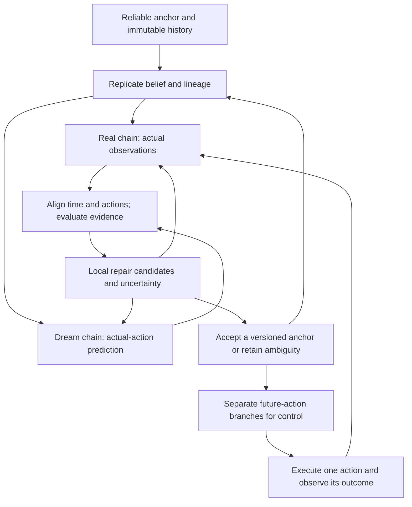

# HelixWM: Replicable Dual Chains and Evidence-Guided Repair

**Design clarification: October 14, 2026. Status: proposed, not implemented or experimentally validated.**

This document records the clarified research intent. It extends the earlier [v0.1 design](DESIGN.md), whose main mechanisms were multistep prediction correction and reliability-gated imagination. The first Walker experiment did not implement or isolate the complete structure proposed here. Its poor final performance is therefore evidence about that implementation and configuration, not a test that can settle this new proposal.

The central idea is **replication from a common history, followed by aligned, bidirectional, local repair**. Like the user's DNA analogy, two related chains provide a way to preserve continuity and correct a damaged segment. The analogy specifies a research architecture; it does not imply biological replication, independent copies of truth, or a guarantee of error correction.

## 1. What is replicated, and what can be repaired?

Replicate a **belief state, its historical context, and a trajectory lineage** at a selected anchor. The Real chain then incorporates actual observations. The Dream chain predicts what should happen under the actions actually executed. They retain separate states even if they share model parameters.

The chains have two roles:

- **Real to Dream:** reliable observations constrain incorrect predictions and re-anchor the predictive trajectory. Observed data can subsequently supervise model learning.
- **Dream to Real:** temporal predictions supply candidate state estimates when an observation or segment is missing, corrupted, or ambiguous. Later reliable observations test and, when justified, revise those candidates.

Repair changes an **inferred state or trajectory**, never the stored camera frames, rewards, executed actions, or physical history. A reconstructed image is a model output with explicit provenance, not a recovered ground-truth photograph. A real fall must remain a fall; the controller may use corrected state estimates to choose better subsequent actions.

Initially, replication does **not** require two complete parameter copies. Separate chain states using a shared, versioned backbone are the minimum feasible design. Separate dynamics models are an optional later ablation with additional compute and representation-alignment requirements.

## 2. Three different error cases

The same Real-Dream disagreement can have different causes. A large residual alone cannot decide which chain is correct.

| Case | Example | Appropriate response | Incorrect response |
|---|---|---|---|
| Observation corruption | Occlusion, missing image, sensor noise | Reduce the corrupted observation's influence, keep predictive alternatives, check the next reliable evidence | Pretend the generated replacement was observed |
| Model or dynamics mismatch | Changed friction, an unmodeled contact, wrong motion prediction | Preserve reliable observation evidence; revise the inferred state and later learn from the mismatch | Reject the observation merely because it disagrees with the model |
| Control failure | The agent really falls or selects a poor action | Represent the failure honestly; reconsider future actions and value estimates | Replace the failure with an imagined successful trajectory |

These cases may overlap. If available evidence cannot distinguish them, the system must retain uncertainty rather than force the chains to agree. Agreement between copies is not independent corroboration, especially when they share parameters and ancestry.

## 3. Alignment and replication contract

Use the existing indexing convention: action $a_t$ produces observation $o_{t+1}$, reward $r_{t+1}$, and continuation $c_{t+1}$. Let $x_t$ denote an unobserved physical state and $b_t$ its learned belief representation. The physical state is not available to the pixel policy.

For an anchor at time $\tau$, create two logical descendants:

$$
b^R_{\tau}=\operatorname{copy}(\bar b_{\tau}),\qquad
b^D_{\tau}=\operatorname{copy}(\bar b_{\tau}).
$$

The copy includes recurrent memory, latent distribution parameters, episode identity, timestamps, and a model-version identifier. If a sampled latent is copied, record that both descendants initially share the same draw. Additional Monte Carlo samples improve approximate inference but do not constitute independent learned models.

For diagnosis over $[\tau+1,t]$, Dream uses exactly the recorded actions $a_{\tau:t-1}$. Real and Dream predictions must have matching episode, time, action sequence, preprocessing, and model version. Never compare an alternative-action prediction directly against the observation produced by a different executed action and call the difference prediction error.

Anchor selection is evidence-based and causal. Low model disagreement alone is not enough to call an anchor reliable. Candidate indicators include valid sensor metadata, consistency across independently observed signals, and predictive residuals whose outcomes have already arrived. The system may have no reliable recent anchor; that case needs an explicit fallback rather than an invented one.

## 4. Minimal inference equations

### 4.1 Prediction and observation evidence

For clarity, first write the idealized filtering model. Let $\mathcal F_t$ contain the observations and metadata available by time $t$, together with already executed actions. Given the preceding corrected belief, the predictive distribution is

$$
\pi_t^-(x_t)=
\int p_\theta(x_t\mid x_{t-1},a_{t-1})
q_{t-1}^{\mathrm{corr}}(x_{t-1})\,dx_{t-1}.
$$

A proposed observation update is a tempered likelihood:

$$
q_t^{\mathrm{corr}}(x_t)
=\frac{1}{Z_t}\,\pi_t^-(x_t)
\exp\!\left[
\sum_{j\in\mathcal O_t}\rho_{t,j}
\log p_\beta(o_{t,j}\mid x_t)
\right],\qquad 0\le\rho_{t,j}\le1.
$$

$\mathcal O_t$ contains available observation components, and $\rho_{t,j}$ denotes their estimated reliability. A missing component contributes no likelihood term. With no available reliable observation, the result remains the predictive distribution, whose uncertainty must still be reported. The component factorization and reliability weighting are modeling assumptions; correlated pixels cannot automatically be treated as independent evidence. An implementation may instead use a coherent whole-image likelihood or a properly specified feature likelihood.

The reliability mechanism must use information available at the applicable decision time. Known validity flags can provide a first implementation without learning a gate. A learned reliability function needs held-out corruption and dynamics-change checks. Defining reliability solely as agreement with Dream would favor the model's own mistakes.

This is a generalized Bayesian inference target, not a claim that the current amortized encoder computes it exactly. It also is not a proof that the learned transition or observation likelihood is physically correct.

### 4.2 Categorical RSSM implementation boundary

In a categorical RSSM, a possible structured approximation for group $j$ is

$$
\log q_{t,j}^{\mathrm{corr}}(c)
=\log p_{t,j}^-(c)+\ell_{t,j}(c)-\log Z_{t,j},
$$

where $\ell_{t,j}$ must represent compatible observation **log-likelihood evidence**, including the chosen reliability treatment. A learned evidence head is one possible approximation, but it requires its own validation. A decoder coupling several groups does not automatically yield this factorized update.

Do not add or average sampled one-hot states and present the result as a categorical posterior. A probabilistic mixture of candidate distributions is permissible if its weights and interpretation are explicit; it is different from this likelihood update.

Most importantly, do not multiply a prior by an existing posterior as though that posterior were an observation likelihood:

$$
q^R(x_t)\propto \pi_t^-(x_t)p(o_t\mid x_t)
\quad\Longrightarrow\quad
\pi_t^-(x_t)q^R(x_t)
\propto [\pi_t^-(x_t)]^2p(o_t\mid x_t).
$$

That construction counts the prior twice. Algebraic removal of a prior is only justified when the posterior and prior are compatible distributions over the same variables with sufficient support; an arbitrary RSSM encoder output does not establish that condition.

### 4.3 State repair versus parameter learning

Online state repair is inference under a fixed model version. It may produce new $b_t^{\mathrm{corr}}$ without updating any network weights. If deterministic RSSM memory is affected, reconstruct it by replaying the actual actions from the chosen anchor through candidate corrected latents. Replacing only the last stochastic latent can leave inconsistent recurrent memory.

Model learning is a separate operation. A possible Real-to-Dream auxiliary objective is the existing matched-action multistep loss restricted to qualified observation-derived teacher targets:

$$
\mathcal L_{R\rightarrow D}
=\frac{\sum_{\tau,k}m_{\tau,k}w_{\tau,k}
\,\mathbb E_{\mathrm{roll}}
D_{\mathrm{KL}}\!\left(
\operatorname{sg}[q^{R,\mathrm{evidence}}_{\tau+k}]
\Vert p^D_{\tau,k}
\right)}
{\sum_{\tau,k}m_{\tau,k}w_{\tau,k}+\epsilon}.
$$

The masks exclude resets, invalid pairs, and unqualified targets. A target already repaired from the same Dream ancestor is not an independent teacher and must not silently be used as real evidence. Conditional rollout KL is an approximation, not exact KL to the full multistep marginal.

Dream-to-Real correction need not introduce a symmetric training loss: the filtering/repair operation already provides that direction of influence. If repair is later amortized into a network, train it against held-out clean evidence or an explicitly frozen, qualified target and preserve gradient isolation. Simultaneous unconstrained mutual imitation can make both branches agree while becoming less informative. Stop-gradient or alternating updates reduce particular feedback paths but alone do not prove that collapse is impossible.

## 5. Local segment repair and reconnection

For a suspected segment $[u,v]$, choose an available anchor $\tau<u$. Generate a bounded set of candidate trajectories under the **executed** actions. Score candidates with available reliable evidence and retain uncertainty over alternatives.

A generic retrospective candidate score, once evidence through time $T\ge v$ has arrived, is

$$
S_m(T)=\log q_{\tau}(x_{\tau}^{(m)})
+\sum_{i=\tau+1}^{T}
\log p_\theta(x_i^{(m)}\mid x_{i-1}^{(m)},a_{i-1})
+\sum_{i=\tau+1}^{T}\sum_{j\in\mathcal O_i}
\rho_{i,j}\log p_\beta(o_{i,j}\mid x_i^{(m)}),
$$

$$
w_m=\frac{\exp S_m(T)}{\sum_n\exp S_n(T)}.
$$

This defines an unnormalized trajectory-density score over candidates, not automatically a valid importance-sampling estimator. If a proposal distribution samples candidates nonuniformly, importance weights require the corresponding proposal correction. Approximate particle filtering, fixed-lag smoothing, or a constrained search may implement this interface, with their respective assumptions documented.

For example, with trajectory proposal density $g(x_{\tau:T}\mid\mathcal F_T,a_{\tau:T-1})$ covering the target support, an importance-weighted approximation uses

$$
\widetilde w_m\propto
\exp\left[S_m(T)-\log g(x_{\tau:T}^{(m)}\mid\mathcal F_T,a_{\tau:T-1})\right].
$$

If the proposal is exactly the anchor distribution followed by the transition prior, those prior factors cancel and the remaining weights use observation evidence. Multiplying by them again would overcount the dynamics prior. Normalize the weights, monitor degeneracy, and keep the candidate budget bounded; this formula alone does not solve long-segment inference.

Reconnection means recomputing the trajectory forward to the current boundary and testing it against observed evidence. Do not splice incompatible deterministic memories at a single frame. Do not cross an environment reset. Preserve rejected candidates and original predictions sufficiently to audit why a repair was accepted.

There are two distinct products:

| Product | Permitted information | Permitted use |
|---|---|---|
| Online corrected belief $q(x_t\mid\mathcal F_t)$ | Evidence already available at time $t$ | Current control and causal evaluation |
| Retrospective repaired segment $q(x_{u:v}\mid\mathcal F_T)$, $T>v$ | Later evidence that has now arrived | Analysis, qualified replay targets, or future decisions after time $T$ |

Retrospective repair cannot change the actions or rewards that already occurred. Offline replay with future evidence must be labeled smoothing, not reported as an online policy improvement. If smoothed targets train a causal estimator, evaluation still must restrict that estimator to its own causal inputs.

When the evidence is insufficient, keep a mixture or select the documented baseline fallback. An arbitrary low-entropy winner is not a successful repair.

## 6. Control after repair

After constructing a corrected current belief, future-action imagination may branch into alternatives:

$$
\{\tilde a_{t:t+H-1}^{(m)},\hat b_{t:t+H}^{(m)}\}_{m=1}^{M}.
$$

These are **counterfactual planning branches**, separate from the matched-action diagnostic chain. They may support the unchanged backbone actor, a later planner, or a value-based selector. Any uncertainty penalty or action selector changes the control algorithm and requires an explicit ablation. Its reward and endpoint value predictions can still be wrong.

The first feasible integration should preserve the pinned backbone's actor, critic, return scaling, entropy treatment, and update schedule. Add corrected-belief input only after its distribution and controller compatibility have been validated. A reliable world-model prediction does not imply a good action or an accurate critic.

## 7. Replaceable modules and fallback behavior

These are proposed interface contracts, not APIs currently provided by the repository.

| Module | Contract | Initial option | Replaceable alternative / fallback |
|---|---|---|---|
| Backbone | Versioned `predict`, `observe`, observation likelihood, distribution schema, recurrent state | One pinned, validated world-model backbone; Helix disabled first | Another backbone only through a schema adapter and fresh disabled-path checks |
| Replicator | Clone anchor state and provenance without altering raw history | Logical forks with shared immutable storage | Independent state samples; full parameter copies only as a separate experiment |
| Alignment | Pair episode, timestamp, model version, actual actions, and preprocessing | Strict replay-index matching | Reject unmatched pairs; never guess missing action alignment |
| Evidence/reliability | Available-observation mask, component reliability, reason and uncertainty | Explicit missing/corruption flags in controlled tests | Learned calibrated reliability; otherwise retain baseline observation processing |
| Repair engine | Candidate distributions, ancestry, evidence score, acceptance/abstention, consistent current boundary | Short causal replay from a reliable anchor | Fixed-lag smoothing for separately labeled retrospective use; abstain when unsupported |
| Model learner | Immutable real samples, qualified teacher targets, detached update paths | Original model loss unchanged | Separately ablated matched-action correction; no automatic promotion of generated targets |
| Controller | Causal belief plus uncertainty; executed action and provenance | Unchanged backbone actor/critic | Separate candidate-action planner; ordinary backbone control if repair is unavailable |
| Auditor | Predictions before outcomes, raw evidence, branch ancestry, runtime and artifact hashes | Append-only evidence record | Disable the extension when necessary evidence cannot be recorded |

Replacing a module must not silently change the action-repeat convention, training budget, optimizer, sensor access, or evaluation protocol. Switching backbone latent spaces invalidates old latent distances unless a new alignment is established. Disable-mode behavior should match the pinned baseline within documented numerical tolerance.

Two independently parameterized models can reduce some shared-error mechanisms, but they double some storage and training costs and introduce latent-coordinate alignment problems. They do not make evidence independent when trained on the same data. Compare this alternative only after shared-backbone replication has a measurable limitation.

## 8. Provenance against self-confirming repair

Each derived segment should record at least:

- Branch ID, parent ID, anchor time, episode ID, model version, and actual-action sequence identity.
- Whether each value is raw observed, predicted, inferred online, or smoothed retrospectively.
- Observation validity and reliability evidence, candidate weights, acceptance reason, and retained alternatives.
- The evidence cutoff time and the time the derived segment became available.
- Whether a proposed learning target depends on predictions from the learner or a shared ancestor.

Raw trajectories remain immutable. A repaired segment is an additional version referencing them. One observation cannot be counted repeatedly merely because several descendants use it. Two descendants sharing an anchor or teacher must not be counted as two independent measurements of confidence.

Clean simulator state may be used as an offline diagnostic reference in controlled experiments, but must not enter a pixel policy or its online gate unless the observation protocol explicitly allows it.

## 9. Feasibility plan and falsifiable tests

This plan is a proposal for subsequent authorization, not permission to launch a new run. It does not modify the archived first experiment.

1. **Establish the unchanged baseline.** Pin the backbone source and configuration. Reproduce stable learning with Helix disabled and verify that the wrapper preserves the original observation, action, replay, and update paths. Preserve the full controller rather than changing both backbone and new mechanism together.
2. **Run a shadow dual chain.** Replicate anchors and produce matched-action predictions without influencing control or gradients. Verify timing, resets, provenance, runtime, and memory. Check that normal motion, occlusion, real falls, and dynamics changes produce distinguishable evidence when possible.
3. **Test repair under controlled observation damage.** Use separate episodes for fitting, reliability calibration, and evaluation. Retain the original clean image only as an evaluator reference. Start with explicit missingness flags and bounded causal repair; compare with the unchanged baseline and prior-only prediction. Evaluate clean episodes as well as damaged ones.
4. **Test retrospective segment repair separately.** Allow bounded future evidence and report the lag. Compare against a causal system at its own information cutoff, without presenting smoothing as free online information. Measure whether reconnection improves state estimation on held-out evidence.
5. **Integrate control, one change at a time.** Compare state repair alone, Real-to-Dream learning alone, their combination, and the disabled backbone. Keep candidate-action planning outside this comparison until the original control path is stable.
6. **Test alternatives only after a useful minimum exists.** Compare independent parameter copies, learned reliability, longer segments, and planners separately, including compute and memory cost.

Pre-register decision thresholds after inspecting baseline variance, before evaluating the new method. Do not choose thresholds by optimizing the final held-out test episodes.

| Question | Evidence required | Failure or abstention criterion |
|---|---|---|
| Does repair recover useful information? | Held-out state/observation error and downstream reward prediction; compare to prior-only and unmodified baseline | No held-out improvement, or errors decrease only on the evidence used to construct the repair |
| Does reliability distinguish bad sensing from bad dynamics? | Calibration and selective-error curves on both corruption and physical-change conditions | Reliable but surprising observations are systematically rejected |
| Does the chain preserve truth and timing? | Immutable raw hashes, reset tests, evidence timestamps, ancestry audit | Generated data labeled observed; future evidence enters online control; prior counted twice |
| Does control improve? | Episode-level returns, failures, action saturation, critic/actor diagnostics, and clean-task performance | Repair degrades clean control beyond the predeclared tolerance or increases catastrophic failures |
| Is uncertainty honest? | Coverage/selective risk and wrong-but-confident repair rate on held-out episodes | Conflicting evidence is forced into confident agreement or abstention is never exercised |
| Is the design affordable? | Peak memory, time per action, training throughput, branch count and repair length | Chosen runtime or memory budget exceeded; branch generation has no bounded policy |

Report environment action decisions, action repeat, environment calls, gradient updates, and compute separately. A larger imagination budget is not an equal-compute comparison. Keep training seeds separate from evaluation seeds; multiple evaluation episodes of one policy do not establish repeatability across training seeds.

The archived first run uses **1,000,000 action decisions and action repeat 2, totaling 2,000,000 DMC calls**. That convention must remain explicit in any comparison. A new experiment needs its own frozen protocol and artifact namespace; it must not overwrite that run.

## 10. Claim boundary

The proposal's identity is **replicable, aligned chains with evidence-guided bidirectional local and segment repair**, followed by control from the repaired belief. Risk gating is a possible supporting mechanism, not the whole idea.

Prediction plus observation filtering, multistep model supervision, and smoothing already have established foundations. Combining them or using a DNA analogy is not by itself a novelty result. The research contribution must be an explicit repair mechanism, defensible information/provenance rules, and evidence that it improves estimation or control beyond appropriate alternatives at stated cost.

This document supplies a candidate architecture and its mathematical constraints. It does not establish optimality, calibrated uncertainty, convergence, error reduction, stable control, or a performance improvement. The immediate engineering priority is a stable unchanged backbone and an auditable shadow chain before coupling the new repair mechanism to learning.

## Foundational references

- [PlaNet: Learning Latent Dynamics for Planning from Pixels](https://arxiv.org/abs/1811.04551) provides a latent dynamics and multistep variational-learning foundation.
- [DreamerV3: Mastering Diverse Domains through World Models](https://arxiv.org/abs/2301.04104) provides a world-model behavior-learning foundation with stability mechanisms. The first pilot in this repository is not an official DreamerV3 reproduction.

These references motivate components of the design. They do not validate the proposed replication, repair rules, or claimed future benefits.
