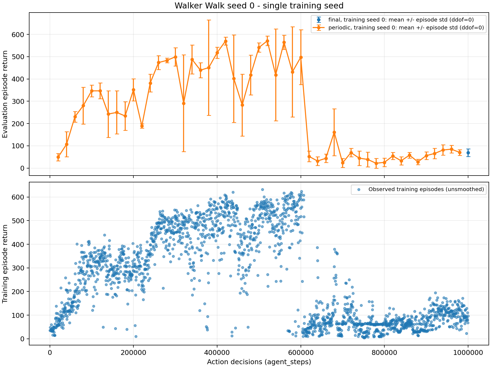

# First Walker Walk pilot: results and failure analysis

**Status:** completed execution and archive verification; failed to retain learned control performance. This is a single-seed pilot, not evidence of HelixWM efficacy or a paper-level reproduction. The initial cause of the regression remains unresolved.

The strongest observed association is a sharp rise in saturated actions alongside a return collapse near 600,000 action decisions. Actor gradient norms and critic loss also rose. These observations prioritize controller stability, but do not identify a single causal bug.

## What was actually run

| Item | Frozen setting |
|---|---|
| Task and input | DeepMind Control Walker Walk, RGB 64 x 64 |
| Training seed | 0 |
| Source commit | [`ac07404f14c2a115140666bce43bc07e2d8c6bf0`](https://github.com/iceezhu306-lgtm/HelixWM-for-world-model/tree/ac07404f14c2a115140666bce43bc07e2d8c6bf0) |
| Training budget | 1,000,000 action decisions; action repeat 2; 2,000,000 DMC `step` calls |
| Learner updates | 199,001 |
| Model and learner | Custom categorical RSSM, tanh-Gaussian actor, scalar value critic |
| Additional mechanisms | Multi-step posterior-to-dream correction, prediction ensemble, reward-error risk head, gated imagination |
| Active replay | Most recent 200,000 decisions in complete episodes |
| Periodic evaluation | Every 20,000 decisions; five fixed seeds, 10000-10004 |
| Final evaluation | Strict final-checkpoint reload; 20 fixed seeds, 10000-10019; no updates |

Evaluation interaction is excluded from the training budget. DMC calls are not MuJoCo integration substeps. The [frozen protocol](../first_experiment_protocol.md) transparently declared this a custom development pilot; **an official DreamerV3 baseline was not run**. The settings are in the [frozen experiment configuration](../../configs/walker_seed0_1m_actions.json).

The original research direction called for retaining a mature base learner and introducing additions separately. This pilot changed the learner and introduced several mechanisms together, so it did not provide that isolation. It also did **not** implement the subsequently clarified DNA-inspired reciprocal repair of aligned Real and Dream state chains. That is a [proposed next design](../DUAL_CHAIN_DESIGN.md), not an achieved result of this experiment.

## Learning outcome

| Checkpoint, action decisions | Mean return | Population episode SD | Evaluation episodes |
|---|---:|---:|---:|
| 520,000: best periodic score | 570.9787 | 21.5846 | 5 |
| 600,000 | 497.6612 | 123.1746 | 5 |
| 620,000 | 52.2934 | 23.7353 | 5 |
| 1,000,000: matched periodic seeds | 67.3107 | 14.5750 | 5 |
| 1,000,000: full final evaluation | 69.3800 | 16.9991 | 20 |

The first four rows use the same five environment seeds. The final row expands to 20 seeds; it is not an identical sample to the earlier rows. Episode SD describes variability within one trained policy, not uncertainty across training seeds. The best checkpoint was selected retrospectively from periodic evaluations and is not the final-budget result.

The model learned useful behavior and then lost much of it. The budget was completed, but completion is not task success. There is no matched baseline, ablation, or independent training seed here; historical experiments with different protocols cannot establish a causal effect of adding Helix.

Sources: [matched evaluation series](evidence/walker_seed0_20261013/matched_evaluation_curve.csv), [final summary](evidence/walker_seed0_20261013/final_summary.json).

## What changed around the collapse

These are left-open, right-closed action-decision windows. Training metric means use log rows, recorded every 100 decisions. Episode means use completed training episodes. Action saturation counts **individual coordinates** of the six-dimensional actions actually saved in replay, not whole actions or evaluation decisions.

| Measurement | (580,000, 600,000] | (610,000, 620,000] |
|---|---:|---:|
| Mean collected episode return | 460.6009 | 32.5301 |
| Completed training episodes | 40 | 20 |
| Saved action coordinates exactly at -1 or +1 | 11.385% | 51.200% |
| Number of action coordinates | 120,000 | 60,000 |
| Mean actor gradient norm, before clipping | 973.4173 | 1299.8034 |
| Mean critic loss | 10.0311 | 23.5486 |
| Mean accepted imagination length, maximum 15 | 14.5900 | 14.5097 |
| Mean actor differential-entropy estimate | -51.9035 | -103.4339 |

The gradient clipping threshold was already 100. A pre-clipping norm above 100 does not mean the optimizer received an unclipped gradient. Differential entropy can be negative; that sign alone is not an arithmetic error. Boundary actions can be useful in control; saturation alone is not proof of a bad policy. The concern is the joint change in action distribution, gradients, value loss, and realized return.

An additional **offline, no-update** checkpoint audit encoded the same four archived sequences independently with each checkpoint. After burn-in, 100 posterior states were retained per checkpoint:

| Checkpoint | Mean absolute pre-tanh actor mean | Deterministic action coordinates exactly at the boundary |
|---|---:|---:|
| 520,000 | 4.8716 | 9.50% |
| 600,000 | 5.3049 | 9.50% |
| 620,000 | 9.0109 | 27.83% |
| 1,000,000 | 21.1911 | 67.83% |

This corroborates saturation on fixed observation sequences, but is not another return evaluation. Each checkpoint has its own representation; the audit does not separate actor-parameter drift from representation drift.

Sources: [window measurements](evidence/walker_seed0_20261013/diagnostic_windows.csv), [checkpoint audit](evidence/walker_seed0_20261013/diagnose_actor_saturation_20261014.json).

## Structural risks and unresolved causes

### 1. Controller stability is the first diagnostic priority

The actor uses

$$
u\sim\mathcal N(\mu_\theta(b),\sigma_\theta(b)^2),\quad
a=\tanh(u),\quad
\sigma=\exp(\operatorname{clip}(\ell,-5,2)).
$$

The mean is unbounded and the minimum standard deviation is about 0.006738. The score-function actor objective uses unscaled advantages. Small standard deviations can amplify score-gradient variability, while large means can saturate `tanh`. These are plausible stability risks, not independently established causes of this run's collapse. In particular, the final checkpoint has a mixture of small and large standard deviations, not a uniformly collapsed standard deviation.

The implementation retains original pre-tanh samples and uses a stable log-Jacobian. The audit did not find an inverse-`atanh` reconstruction bug in the training score. Existing clipping constrains gradient norm, not the resulting policy change. Code: [`TanhGaussianActor`](../../helixwm/control.py#L26), [`control_update`](../../helixwm/control.py#L282).

### 2. Reward-prediction reliability is not policy quality

The implemented prefix risk target is

$$
Y_{t,k}=\mathbf 1\!\left[\max_{1\le j\le k}
\frac{|r_{t+j}-\hat r_{t,j}|}{2}>0.25\right].
$$

It asks whether a reward prediction under the recorded action sequence has error greater than 0.5, not whether the action is good. Accurate prediction of a fall and low reward can be reliable under this target. It also does not directly test bootstrap endpoint value error. The nearly full accepted horizon contradicts a simple explanation that the gate closed everywhere and removed all learning signal. Training-batch Brier scores are not held-out calibration evidence. Code: [risk labels](../../helixwm/reliability.py#L174), [auxiliary update](../../helixwm/control.py#L227).

### 3. Replay turnover may impede recovery

The active sampler uses a 200,000-decision FIFO window. Successful experience collected near 520,000 decisions leaves active sampling by approximately 720,000 decisions, although its archived files remain preserved. A failure-heavy recent buffer could make recovery harder. This is a candidate feedback mechanism, not an explanation established for the initial trigger. Code: [active replay eviction](../../helixwm/replay.py#L152).

### 4. Several alternatives remain untested

Training samples posterior categories whereas evaluation chooses deterministic categories. Training returns also fell, so this difference alone does not explain the observation; a matched checkpoint comparison remains useful. Error histories reflect collection-time models, while risk labels use the current model; model-age effects have not been isolated. Stable reconstruction or KL losses on a changing replay distribution do not establish stability on a fixed set of previously successful trajectories.

The audit did not identify a clear action/reward index error, reversed KL direction, or missing boundary bootstrap. That is a limited audit result, not proof of correctness of all mathematics or code.

## Engineering acceptance is separate from efficacy

- Training reached the declared budget and exited normally. All numeric values in the 12,000 recorded metric rows were finite.
- The 999 resource samples recorded zero OOM, OOM-kill, and memory-limit events. Sampled memory peaked at 17.2445 GiB against a 90 GiB limit; this is a sampled peak, not a continuous maximum.
- The final checkpoint reloaded strictly; learner and all five optimizer states were checked, with unchanged hashes across frozen evaluation.
- The archive contains 100 checkpoints, 2,000 replay episodes, raw results, logs, configuration, source, one formal-stage MP4, and learning-curve PNG/PDF. The video was fully decoded.
- ZIP integrity, exact archive membership, and extracted per-file SHA256 verification passed for 2,360 files. The archived evidence is retained unchanged.

These checks support execution and preservation claims, not a performance improvement. The compact [acceptance summary](evidence/walker_seed0_20261013/acceptance_summary.json) records that distinction. This public report contains compact evidence; it does not imply the full checkpoint/replay archive is hosted in this repository.

## Changes to make the next study informative

1. Fix a mature base learner and verify it under the intended observation, budget, and evaluation protocol. Preserve its actor, critic, and training-stability mechanisms. Do not add several controller fixes and Helix components in a single comparison.
2. Audit fixed successful and failed sequences across existing checkpoints, separating model prediction, critic error, action distribution, and calibration. Treat candidate changes such as return-scale normalization or policy parameter bounds as testable interventions.
3. Implement the [clarified dual-chain design](../DUAL_CHAIN_DESIGN.md) as separable modules. Clone aligned state/history rather than assuming two full networks are required. Keep reliable observations as evidence; generated repairs must remain marked as predictions.
4. First evaluate localization and state repair on predeclared observation corruptions with known clean targets, without allowing future observations into online decisions. Evaluate retrospective repair separately. Only then test the effect on control.
5. Compare a matched base learner, observation-side repair alone, model-side correction alone, and their combination. Include no-repair and simple masking/temporal-prediction controls. Retain final-budget results and multiple training seeds before claiming general improvement.

These are proposals. No proposed repair, retraining result, or reciprocal dual-chain performance improvement is claimed in this report.

## Mathematical caveat: action-dependent gating

At a fixed state, with the gate and value functions treated as fixed during the update, an action-dependent gate generally yields

$$
\mathbb E_\pi[g(a)(Q(a)-V)\nabla\log\pi(a)]
=\nabla\mathbb E_\pi[g(a)Q(a)]-V\nabla\mathbb E_\pi[g(a)].
$$

The second term need not vanish. Therefore the ordinary state-baseline cancellation argument does not directly justify this gated estimator. The implemented accepted-count normalization and trajectory stopping rule require their own objective analysis. The code describes a gated surrogate rather than an unbiased policy-gradient guarantee. Almost-full gate coverage in this run does not establish this caveat as the cause of the collapse; replacing a hard mask with a soft weight alone would not remove action-dependent selection.

## Compact evidence index

The [raw evaluation rows](evidence/walker_seed0_20261013/eval_raw.csv) include 245 periodic episodes and 20 final episodes. The [resource summary](evidence/walker_seed0_20261013/resource_summary.json) preserves the recorded memory and OOM measurements. The [provenance record](evidence/walker_seed0_20261013/provenance.json) includes source-file hashes and recomputation checks for the final statistics and matched five-seed curve. Large model, replay, video, and complete log artifacts remain in the original local archive.
