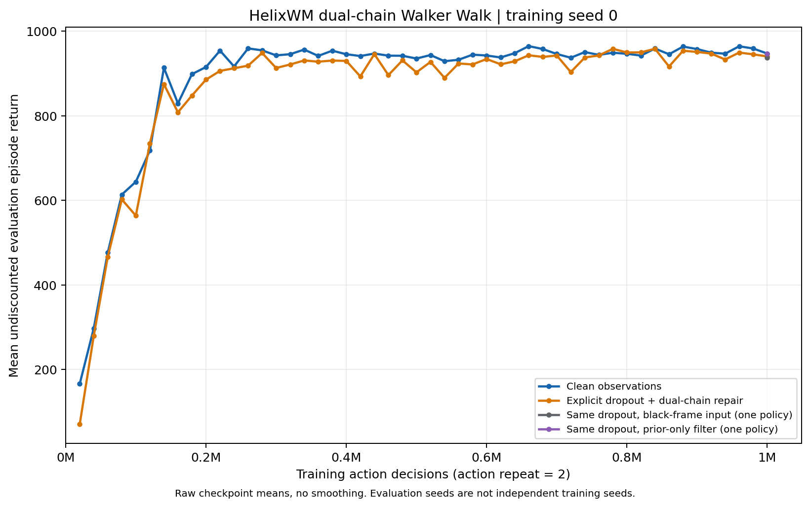

# Second Walker experiment: completed bounded dual-chain run

Published: 2026-10-18. Training completed on 2026-10-15. This is one training seed with four frozen inference interventions, not four independently trained models or a multi-seed efficacy claim.

The second implementation completed its budget and retained high clean-observation return. It also controlled Walker under known short missing-frame bursts. Its candidate-repair intervention did **not** demonstrate an incremental return advantage over ordinary single-prior propagation. The whole-system improvement over the first pilot must not be attributed solely to replication or repair.

## Experiment identity and preserved evidence

| Field | Recorded value |
|---|---|
| Run | `dual_chain_walker_seed0_1m_20261014` |
| Task / input | DeepMind Control Suite Walker Walk, 64 x 64 RGB |
| Training seed | 0 |
| Budget | 1,000,000 executed action decisions; action repeat 2; 2,000,000 DMC calls |
| Completed training episodes / learner updates | 2,000 / 248,750 |
| HelixWM source | [`80cb3555586d01e0e7b0e8d362c27e540032d901`](https://github.com/iceezhu306-lgtm/HelixWM-for-world-model/tree/80cb3555586d01e0e7b0e8d362c27e540032d901) |
| Official DreamerV3 source | [`e3f02248693a79dc8b0ebd62c93683888ddaccfe`](https://github.com/danijar/dreamerv3/tree/e3f02248693a79dc8b0ebd62c93683888ddaccfe) |
| Logged training time | 105,603.724 seconds, approximately 29.33 hours; excludes the final evaluation |
| Start to completion | 105,882.182 seconds, approximately 29.41 hours; includes finalization |
| Final checkpoint | `checkpoint_001000000.pkl` |
| Final checkpoint SHA256 | `8aba0d3c6a1e9116850f34d24caf2fcdc0c68232d849d5bebbb9ec6239c8816e` |

See the [actual configuration](../../results/2026-10-14-dual-chain-walker-seed0/config.json), [source/export provenance](../../results/2026-10-14-dual-chain-walker-seed0/provenance.json), and [frozen protocol](../dual_chain_experiment_protocol.md). DMC calls are not MuJoCo integration substeps. Evaluation interactions are additional and excluded from the training budget.

The full local archive preserves 100 checkpoints, 2,000 replay episodes, logs, source, configuration, dependency information and recovery evidence. Recorded acceptance passed normal exit, full budget, checkpoint-linked strict reload evidence, frozen model/optimizer/counter hashes, archive CRC, and per-file extracted SHA256 checks. Those are archived execution/acceptance results; this publication did not run another local JAX reload or a new experiment.

The full ZIP contains 4,409 payload files, is 14,571,651,605 bytes, and has SHA256 `10052e00f3b3e62cc04fa4c78ac66bdaa42425945b6c3e38610a78f2f853a5d0`. It remains in the separate local experiment archive. This repository publishes a compact, reviewed evidence subset; it is not the full checkpoint/replay archive. Recomputing the published statistics requires only the exported numerical data. Re-running the trained policy additionally requires the separately preserved checkpoint and compatible runtime.

## Final frozen results

All conditions use the **same trained checkpoint**, 20 environment seeds `10000..10019`, and fixed private inference RNGs. The three missing-observation conditions have matching per-seed availability hashes. They are paired by exogenous schedule and initial seed; their actions and later physical trajectories can differ.

| Condition | Observation handling | Mean return | Episode population SD |
|---|---|---:|---:|
| `clean` | Ordinary observation filtering | 946.88 | 22.84 |
| `dropout` | Prior-proposed candidate histories and returning-evidence selection | 940.04 | 25.33 |
| `dropout_disabled` | Black image through the ordinary filter | 937.46 | 30.14 |
| `dropout_prior_only` | One prior state during missingness, ordinary observation update on return | 946.06 | 18.92 |

Episode SD is not variation across independently trained seeds. The final missingness schedule masked 563 of 10,000 action-associated observations, or 5.63%. Each sampled burst has length 1 to 5, but adjacent bursts can join: reconstructing the exact schedules and matching all 20 saved availability hashes found **188 contiguous gaps, including three of length 7 and one of length 8**. The full length histogram is `{1:45, 2:34, 3:33, 4:38, 5:34, 7:3, 8:1}`. All four long gaps triggered repair abstention at the sixth missing observation. The configured burst-start probability of 0.02 is not the resulting masked fraction. This corrects the earlier shorthand that all realized gaps were at most five observations.

Paired return differences use 50,000 bootstrap resamples of the 20 environment-seed pairs, RNG seed 20261017, and percentile 95% intervals:

| Contrast | Mean difference | Paired bootstrap interval |
|---|---:|---:|
| Repair minus black-frame filtering | +2.58 | [-8.76, 12.98] |
| Repair minus single-prior propagation | -6.03 | [-15.15, 1.86] |

Both intervals include zero. This does not prove equivalence, harm, or a stable repair benefit. The intervals condition on this one trained model; they do not measure training-seed uncertainty. This retrospective analysis is exploratory, not a preregistered confirmatory test.

## Comparison with the first pilot

| Measurement | First custom pilot | Second implementation |
|---|---:|---:|
| Final clean mean, 20 episodes | 69.38 | 946.88 |
| Clean mean at 200k actions, 5 episodes | 351.58 | 914.98 |
| Clean mean at 600k / 620k actions | 497.66 / 52.29 | 942.25 / 937.64 |
| Logged training hours | 16.73 | 29.33 |
| Learner updates | 199,001 | 248,750 |

The final descriptive difference is +877.50 return. From 600k through 980k actions, the second run's periodic clean means stayed between 936.95 and 964.39. The first pilot suffered a large late regression. These observations establish a better whole-system outcome for these two runs, not the causal contribution of the new repair module.

The comparison changes the custom PyTorch learner to the official DreamerV3 learner, numerical stabilization, model capacity, replay capacity, sampled sequence context, update count, and evaluation sampling rules. The first pilot used deterministic actor/posterior choices, whereas the second retained native stochastic inference. Both use the same action budget, but computation is not matched: logged training time rose about 75%, and update count about 25%. The first pilot did not have a matched dropout audit. Historical DreamerV3/EAWM/DrQ-v2 results also have different inputs or budgets and are not matched controls for this experiment.

## Mechanism diagnostics and continuity limits

There were 184 final `repair_reconnected` events. With 8 candidates, mean effective sample size was 7.94784 and the largest candidate weight averaged 0.13697, compared with 0.125 for uniform weights. Returning observations therefore produced relatively weak weight separation in this evaluation. High ESS is not inherently an error: candidate similarity, score discrimination and temperature are competing explanations, not established causes.

The [implemented mechanism](../../helixwm_v2/dual_chain.py) copies latent states and histories under a shared model; it does not create independently learned world models. Every candidate follows the actual executed actions. During a gap, the current controller state can be sampled from different candidates on successive steps. On a successful reconnect, the returning frame scores candidates and the selected prior-proposed state becomes the current belief. It is already observation-weighted, even though that branch does not additionally call the ordinary encoder posterior. Altering either rule is a separate design intervention, not an automatic bug fix.

| Continuity claim | Evidence boundary |
|---|---|
| Known synthetic missing observations | Tested in simulation, sampled bursts of 1-5 with occasional joined gaps of 7-8; high aggregate return |
| Gaps longer than the 5-observation repair budget | Four observed 7/8-step gaps triggered single-prior fallback at step 6; no controlled length-sweep or long-gap reliability claim |
| Unknown blur, occlusion, or frozen camera | No learned fault detector was evaluated; availability was supplied explicitly |
| Changed friction, contacts, or actuation | Not tested; task dynamics and rewards stayed unchanged |
| Learning a new environment after a fault | Not tested by the final frozen audit; all parameter/optimizer hashes and counters were unchanged |
| Real-world or indefinite safe operation | Not established |

Clean simulator frames remain available in the training archive, even when hidden from the collector. The world model learns from those actual clean targets. This is a declared synthetic missing-observation experiment, not unsupervised recovery of permanently unavailable real-world images. Inferred histories never overwrite observations, rewards or executed actions.

## Published data, figures, video, and code

- [Per-episode V2 evaluation data](../../results/2026-10-14-dual-chain-walker-seed0/eval.csv), [V1 comparison data](../../results/2026-10-14-dual-chain-walker-seed0/v1_eval.csv), [repair events](../../results/2026-10-14-dual-chain-walker-seed0/repair_events.jsonl), and [recomputed summary](../../results/2026-10-14-dual-chain-walker-seed0/summary.json).
- [Learning curve PNG](../../results/2026-10-14-dual-chain-walker-seed0/plots/learning_curve.png) and [PDF](../../results/2026-10-14-dual-chain-walker-seed0/plots/learning_curve.pdf).
- [Training diagnostics PNG](../../results/2026-10-14-dual-chain-walker-seed0/plots/training_diagnostics.png) and [PDF](../../results/2026-10-14-dual-chain-walker-seed0/plots/training_diagnostics.pdf).
- [One formal clean rollout MP4](../../results/2026-10-14-dual-chain-walker-seed0/videos/clean_training_final.mp4): predesignated first final clean seed, 501 frames at 20 fps. It demonstrates the clean condition, not the missing-frame or future stress conditions.
- [Portable analysis](../../scripts/analyze_second_experiment.py), [V2 collection/training](../../helixwm_v2/train.py), [frozen evaluation](../../helixwm_v2/evaluation.py), and [checkpoint/replay implementation](../../helixwm_v2).

The [next comparison framework](2026-10-18-continuity-framework.md) starts with frozen-model stress tests and isolated inference changes. It is a design for subsequent work, not evidence that those tests have run. Existing results and the frozen source revision remain unchanged.
