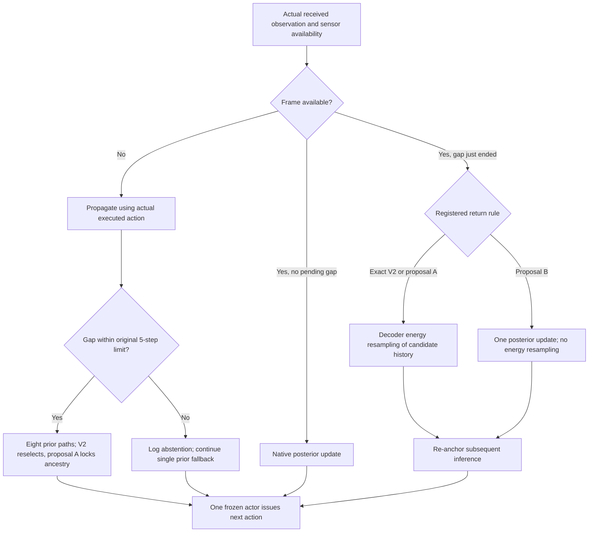

# Continuity study V3: design before execution

**Status: DESIGN_ONLY. No new experiment, training run, or stress-test result is reported here.** The companion [design manifest](../../configs/continuity_study_v3.json) is not a runnable training configuration. Its runner is not implemented, execution is not authorized by this document, and training updates are prohibited in the first study.

## 1. Question and fixed starting point

Can the completed HelixWM V2 policy maintain useful Walker Walk behavior through an observation interruption, recover when valid observations return, and improve on a simple prior-only fallback?

The first study reuses the **final 1,000,000-action V2 checkpoint**, trained with repeat 2, rather than training another model. Preserve runtime commit `80cb3555586d01e0e7b0e8d362c27e540032d901` and official DreamerV3 commit `e3f02248693a79dc8b0ebd62c93683888ddaccfe`. The accepted local checkpoint was read-only SHA256 verified for this publication as `8aba0d3c6a1e9116850f34d24caf2fcdc0c68232d849d5bebbb9ec6239c8816e`; verify that same hash again before future execution. A filename or action counter alone is insufficient identity. Do not select a different checkpoint after seeing stress-test results.

The completed experiment changed the backbone, learner, and training setup relative to the first pilot. Its improvement cannot all be attributed to dual-chain repair. Existing frozen controls also did not establish that candidate repair outperforms prior-only inference. This framework therefore tests a narrower mechanism claim on one fixed trained policy. It does not compare independently trained algorithms or establish multi-seed training robustness.

The [completed V2 report](2026-10-14-dual-chain-walker-seed0.md) distinguishes sampled bursts from actual contiguous gaps: nominal 1-5-frame bursts sometimes joined, yielding three 7-step gaps and one 8-step gap in final evaluation. These four cases invoked fallback at the sixth missing frame. They are incidental fallback evidence, not a controlled long-gap benchmark. The fixed schedules below avoid that ambiguity.

There are three different questions, evaluated in separate phases:

| Phase | Problem | What the policy may know | Status |
|---|---|---|---|
| A | Known missing observations, short through long gaps | Explicit availability; received RGB and past executed actions | First planned frozen-checkpoint comparison |
| B | Uncertain observations: stale, obscured, or corrupted images | Observable sensor metadata and received pixels; no oracle corruption labels in the detector arm | Later design; detector and corruption runner absent |
| C | Changed physical dynamics | Actual received observations; no simulator parameter or change flag supplied to the policy | Separate future protocol; adaptation absent |

Passing A is not evidence of automatic fault detection, physical adaptation, real-world safety, or indefinite operation. Walker episodes end at a time limit; merely reaching that limit is not successful recovery.

## 2. Existing mechanism and the two proposed interventions

Let the shared frozen world model have recurrent state $s_t=(h_t,z_t)$, prior transition $p_\theta(s_t\mid s_{t-1},a_{t-1})$, observation-conditioned update $q_\theta(s_t\mid s_{t-1},a_{t-1},x_t)$, and policy $\pi_\theta(a_t\mid s_t)$. These are schematic conditional distributions; the actual RSSM contains a deterministic recurrence and stochastic latent. All arms retain the same trained parameters $\theta$, actor distribution, clipping, and private actor RNG convention.

### Current V2, preserved exactly

At the first missing frame, V2 copies the last valid control state into eight candidates. Each candidate follows the **same actual executed actions**, with independent prior samples:

$$
s_t^{(i)}\sim p_\theta(s_t\mid s_{t-1}^{(i)},a_{t-1}),\qquad i=1,\ldots,8.
$$

No current missing image is encoded. During the gap, V2 selects one candidate for the actor at each step. The weights remain uniform until valid evidence arrives, so the control belief can switch between candidate paths even though each individual path is causally valid. This is not branching over alternative actions or voting across eight actors.

At a valid return frame $x_r$, V2 advances the candidates with the last executed action and uses decoder energy $E_\theta$:

$$
w_r^{(i)}=\operatorname{softmax}_i\left(\log w_{r-1}^{(i)}+
\frac{E_\theta(x_r,s_r^{(i)})}{12288\,\tau}\right),\qquad
I\sim\operatorname{Categorical}(w_r),\quad s_r=s_r^{(I)},\quad \tau=0.01.
$$

The score is an image reconstruction energy, **not a calibrated likelihood**. Prior-proposed paths do not receive an additional prior factor. The return image already affects state selection; V2 does not also encode it in a posterior update in this successful branch. A subsequent ordinary valid frame uses the normal observation update. Low effective sample size is logged, not currently a safety trigger.

After more than five consecutive missing frames, exact V2 records an abstention, discards pending repair candidates, and continues with a single prior state. The next valid image is handled by the ordinary posterior update. This fallback continues issuing bounded actions; it does not prove they remain useful or safe.

These details are implemented in [dual_chain.py](../../helixwm_v2/dual_chain.py), especially `act`, `_start_candidates`, `_advance_candidates`, and `step`. The missingness flag is currently supplied by [evaluation.py](../../helixwm_v2/evaluation.py), not inferred by an anomaly detector.

### Proposal A: keep one candidate ancestry during a gap

Select an index $I_g$ once at the first missing observation and retain it for control during that gap:

$$
s_t^{\mathrm{control}}=s_t^{(I_g)},\qquad g\le t<r.
$$

Continue propagating all eight candidates along the actual actions. Keep V2's return-frame weighting, maximum repair length, and long-gap fallback unchanged. Consume and discard the original subsequent per-step selection draws so that the repair RNG's later call position remains comparable; log both the proposed draw and the index actually used. Separate actor RNG streams remain unchanged.

This isolates whether switching control belief across candidate paths matters. It is a hypothesis, not a diagnosed bug or a guaranteed improvement. The locked candidate may also be a poor sample.

### Proposal B: use the return image once through the native posterior

Leave V2's missing-step behavior unchanged. At the first returning valid image, replace energy resampling with one native observation update from the **pre-return control state**:

$$
s_r\sim q_\theta(s_r\mid s_{r-1}^{\mathrm{control}},a_{r-1},x_r).
$$

Do not first select an ancestor using $x_r$, and do not multiply by its decoder evidence again. This is an alternative assimilation rule, not an additional correction on top of V2 weighting. It sacrifices V2's return-image selection among complete candidate histories; archive those histories as unselected diagnostics, not as successfully repaired historical states. Use the existing real-filter RNG for this single observation update and preserve the actor stream.

After a gap exceeding five observations, exact V2 already uses this ordinary posterior following fallback. Proposal B changes only the bounded-repair return branch; its long-gap behavior must match the reference, including RNG behavior. It does not extend the repair horizon. For this proposal, the 10/20/50-gap cases are parity controls, and the registered primary average deliberately retains their zero differences rather than hiding those cases.

Energy-weighted selection followed by another posterior update from the same frame is **not** included in the first study. Such a combined particle proposal would need a derived target/proposal importance correction or another justified inference construction; two uses of the same evidence are not automatically independent. A combined locked-ancestry plus posterior-return arm would likewise be a later, separately registered interaction test, not a hidden change to either proposal.

The diagram includes **planned** alternatives. Only the existing V2 route is implemented in the preserved runtime.

## 3. Phase A: paired frozen-checkpoint comparison

### Arms

| ID | Missing-frame handling | First valid frame after a bounded gap | Implementation status |
|---|---|---|---|
| `clean` | No injected gap; original V2 clean path | Native observation update | Existing control |
| `black_frame` | Pass zero pixels as if valid, repair disabled | Native observation update | Existing control |
| `prior_only` | Explicitly skip invalid image; single prior, repair disabled | Native observation update | Existing control |
| `v2_exact` | Original eight candidates and repeated selection | Original energy resampling | Frozen reference |
| `locked_ancestor` | Proposal A only | Original energy resampling | Not implemented |
| `posterior_return_once` | Original V2 missing-step behavior | Proposal B only | Not implemented |

Map the four existing controls to `clean`, `dropout_disabled`, `dropout_prior_only`, and `dropout` in the existing evaluator. Preserve V2's `max_missing=5` and eight-candidate budget in all candidate arms. Gaps of 10, 20, and 50 actions deliberately exercise the existing abstention/fallback; they do not silently expand its repair horizon. Increasing that horizon would change memory, cost, and inference behavior and requires a separate intervention.

### Exact schedule and index convention

An episode has 500 action decisions and at most 1,000 DMC calls, with repeat 2. Let $x_t$ be the observation available **before** action $a_t$, for $t=0,\ldots,499$. The returned observation after the first $t$ executed actions is passed to `chain.step(..., timestamp=t)`; the following `chain.act()` produces $a_t$. Do not confuse a missing returned frame with the reward earned by the preceding action.

Use exactly one exogenous gap per fault episode, starting at $g=150$: observations $x_g,\ldots,x_{g+L-1}$ are unavailable for $L\in\{1,5,10,20,50\}$. The first returned valid frame is $x_{g+L}$. Initial and final observations remain valid. This deterministic schedule prevents adjacent random bursts from unintentionally changing the requested duration. Record the full mask and its SHA256, not just a seed. No reward-dependent onset, recovery-dependent end, or best-looking event selection is allowed.

For each seed, run clean once and each of the five fault arms at each duration: 26 episodes. A clean trajectory can supply the fixed reference windows for all durations; duplicating it does not create independent samples. Identical seeds, actor-RNG conventions, and exogenous masks provide pairing, **not identical trajectories after actions diverge**. Compare pre-fault action/image hashes where parity is expected, and log any mismatch instead of assuming it.

### Development and held-out split

- Design/debug seeds: **20000-20019** (20). They may be used to implement and inspect the stated variants.
- Confirmatory held-out seeds: **30000-30039** (40). Do not run them until source, checkpoint/config hashes, schedules, metrics, and analysis code are frozen.
- Historical final seeds **10000-10019 are excluded** from tuning and from this new confirmatory set. Historical results remain historical results.
- Use a private actor seed `2000000 + environment_seed` and independent named real/dream/repair RNG streams. Store exact RNG states and stream derivation. Preserve source behavior for the V2 reference; do not reimplement it approximately to obtain a convenient RNG match.
- After any design change prompted by held-out results, label those results exploratory. A new confirmation requires a newly registered, untouched split; do not repeatedly test and tune on this set.

The full planned matrix is 520 design episodes plus 1,040 held-out episodes, at most **780,000 evaluation actions / 1,560,000 DMC calls**. It contains **zero training updates**. These costs are separate from the checkpoint's completed training budget. Measure wall time, peak memory, and inference latency before deciding whether to execute the full design; this document does not authorize spending that compute.

## 4. Fixed outcome definitions

For action $t$, normalize its summed reward by the number of executed DMC calls: $u_t=r_t/n_t$. Report raw episode return as well, on the original sum-of-DMC-rewards scale. Do not renormalize each arm to its own best episode.

Pre-fault reference: $\mu_{\mathrm{pre}}=\frac1{50}\sum_{t=g-50}^{g-1}u_t$. Fault window: $[g,g+L)$. Recovery window: $[g+L,g+L+100)$. All specified windows fit within 500 actions.

| Metric | Exact definition and limitation |
|---|---|
| Full episode return | Sum of all 500 action rewards, with actual call counts recorded. Report every seed, including errors or poor pre-fault behavior. |
| Fault reward | Mean $u_t$ during the fixed missing-observation window. Measures useful control while observations are absent. |
| Recovery reward | Mean $u_t$ over the fixed 100 actions after the first valid frame. |
| Paired integrated deficit | $D_{s,a,L}=\frac1{L+100}\sum_{t=g}^{g+L+99}(u_{s,\mathrm{clean},t}-u_{s,a,L,t})$. Lower is better; negative values are permitted. Clean and fault trajectories can differ. |
| Recovery time | If $\mu_{\mathrm{pre}}\ge0.75$, earliest post-return action at which a trailing 10-action mean reaches $0.9\mu_{\mathrm{pre}}$ for 10 consecutive checks, with windows entirely after return. If absent within 100 actions, record right-censored `>100`; do not replace it with zero or average only recoveries. If pre-fault score is below 0.75, mark recovery-time eligibility false and retain that episode in all other metrics. |
| Functional failure | At least 20 consecutive actions with $u_t<0.2$ anywhere in the fault-plus-100-recovery window. This is a declared low-task-performance proxy, **not a physical fall or safety diagnosis**. |
| Evaluator-only posture failure | Sample torso height and its vertical-axis alignment after each action. Let $h_{\mathrm{pre}}$ be mean height over the pre-fault window. The provisional design definition is 10 consecutive action samples where height is below $0.65h_{\mathrm{pre}}$ **or** vertical alignment is below 0.5. Report the first occurrence and fraction of affected episodes. Validate the exact simulator accessors and threshold behavior on design seeds only; freeze the resulting definition before held-out execution. |
| No-posture-failure proxy | No evaluator-defined posture failure and no technical failure during the fault-plus-recovery window. Also report the full-episode counterpart separately. This operational simulation measure is not a certified physical safety or fall detector. |
| Technical failure | Nonfinite or invalid action, exception, corrupted state, process failure, or unexpected termination before the time limit. Log time/reason; count as a failed case. Zero-fill remaining planned reward positions for the primary conservative analysis and show complete-case sensitivity separately. Never quietly drop the case. |
| Bounded operation | Fraction of requested actions actually issued without a technical failure. This alone is not task success or survival. |
| Inference diagnostics | ESS, selected candidate changes, gap length, abstentions/reasons, observation-update counts, actor saturation fraction, peak memory, wall time, and per-action latency p50/p95/p99. Diagnostic variables are not substitute success metrics. |

Do not call normal time-limit completion "survival." Posture instrumentation is **not implemented** in the current evaluator. The future runner must read the pinned simulator's actual torso pose through an evaluator-only channel, record units and exact field/accessor names, and calibrate the provisional posture proxy against rendered design cases before locking it. Degenerate or non-upright pre-fault cases must be flagged, not used to normalize away a failure. These values must not reach the policy, candidate scores, validity decision, or stopping controller. The primary outcome remains the fixed reward deficit; any revision of a secondary posture threshold must be registered before held-out execution. No threshold is tuned on seeds 30000-30039.

### Analysis and decision rule

The primary scalar for each environment seed and arm is the equally weighted mean of $D_{s,a,L}$ over the five registered durations. Report the per-duration values as secondary outcomes; do not cherry-pick the easiest duration.

Compute paired mean differences, raw seed-level tables, and 95% intervals using 10,000 bootstrap resamples of **whole environment-seed clusters**, preserving all durations/arms within a cluster. Use the manifest's fixed analysis seed. For confirmatory superiority claims, use one-sided paired sign-randomization tests of `proposal deficit - comparator deficit` (alternative: negative), with 100,000 draws and Holm correction across four predeclared comparisons: each proposal versus exact V2 and versus prior-only. State the paired-exchangeability assumption of this test; a p-value does not remove the limits of one trained policy and a finite seed set. Report unadjusted effects and adjusted p-values, not only a binary decision. These intervals describe evaluation variability for **one training seed**.

A proposal earns only a **limited recommendation for follow-up** if it improves the primary deficit against **both** exact V2 and prior-only in the held-out analysis, with adjusted p < 0.05, and passes a descriptive failure guard: its observed functional-failure count, summed across all 40 seeds and five durations, must not exceed either comparator's count. Publish every seed/duration flag and the duration-specific counts; the 200 cases per arm are correlated within seeds and are not 200 independent safety trials. The guard requires all planned failure outcomes to be available; unresolved technical failures or missing outcomes make it inconclusive. It is not a statistical noninferiority or safety test. The proposal must also pass exact clean-path parity and frozen-state checks. A clean mismatch invalidates the isolation claim and must be explained before confirmation. A failed superiority test, observed failure increase, or unresolved guard must be reported as negative or inconclusive without retuning thresholds after inspection.

Report rare-failure uncertainty separately. For each arm and held-out seed, define a **cluster event** as at least one functional failure across its five registered durations. Let $k$ be the number of affected seed clusters out of $n=40$. Publish the one-sided 95% exact Clopper-Pearson upper interval $[0,U]$ under an independent, exchangeable seed-cluster binomial model: $U=\operatorname{BetaQuantile}_{0.95}(k+1,n-k)$ when $k<n$, and $U=1$ when $k=n$. This estimates the risk of **any failure across the duration suite**, not the mean per-duration failure probability or a paired risk difference. Keep those quantities labeled separately.

Even if $k=0$, $U=1-0.05^{1/40}\approx0.0722$: **zero failures in 40 clusters still has a 7.22% one-sided upper bound**. A percentile bootstrap that resamples only zero-event clusters would return zero and cannot certify a 5-percentage-point risk bound. This study therefore makes no such certification. Long-gap failures remain visible even if the mean reward improves. A safety or noninferiority claim needs a separately planned, adequately powered study with its own risk estimand and analysis; no result here alone licenses real-world deployment.

## 5. Phase B: uncertain observations, not oracle availability

Plan a separate sensor-corruption study only after A is implemented and reviewed. Use three families: delayed/stale frames, a fixed pixel occluder, and blur/noise. Freeze every renderer parameter, duration, metadata field, detector threshold, split, and cost before confirmation. None of these perturbations currently exists as a validated study runner.

Separate (1) an oracle-availability diagnostic upper reference, (2) observable sensor metadata such as frame age or acquisition failure, and (3) a proposed visual reliability detector. The oracle synthetic label belongs only to the diagnostic reference/evaluator; it must not leak into the deployed detector arm. A real image of a physical fall or new dynamics is not automatically a corrupt sensor image. Reconstruction disagreement alone cannot establish that distinction.

If a detector is proposed, fit/calibrate only on design data and separately report false-positive rate on clean but difficult behavior, missed-fault rate, detection delay, score calibration, and downstream reward/recovery. A nominal 1% clean false-positive target is a design constraint to validate, not a promised result. Observation-energy temperature or abstention-threshold calibration is an optional later one-component study, never silently folded into A. Low ESS may be investigated as a confidence feature, but is not currently an implemented safe fallback.

## 6. Phase C: true dynamics changes and possible adaptation

Maintain **actual valid observations** while changing one physical factor at a time, such as body mass or actuator strength. Register physically meaningful parameter locations, permitted values, change timing, and whether changes persist before implementing this protocol. Do not combine a camera gap and a dynamics change in the first causal comparison. The policy receives neither simulator parameters nor an oracle change flag.

Initially compare frozen inference under the registered change. Online parameter adaptation would be a **new algorithm and authorization scope**: specify what losses are updated, update budget, training/evaluation separation, raw-data provenance, replay balance, monitoring, and rollback criteria. Evaluate retention on the original dynamics after adaptation, held-out changed dynamics, and recovery after reverting the change. Genuine missing real-world frames cannot become supervised clean labels; generated trajectories remain marked inference, not observations.

If later matched training is authorized, use the same pixels/repeat-2 environment, learner/backbone, model size, sampler, compute accounting, evaluation protocol, and **1,000,000 actions / 2,000,000 DMC calls per training arm**. Report burn-in, inference/repair overhead, and actual update counts in addition to interaction budgets. Independent training seeds are desirable for a future robustness claim but are not authorized or scheduled here. No new training is needed to answer Phase A's fixed-checkpoint question.

## 7. Future implementation boundary and gates

Do not edit the preserved `helixwm_v2` reference while executing this design. Future implementation should add a separate study runner and isolated variant adapters, then bind their new source commit in a new manifest. The current files and this JSON do not implement that runner.

Proposed integration contract:

1. Strictly reload the accepted final checkpoint using the existing backbone loader and pin one inference version. Record checkpoint SHA256, configuration, upstream/source commits, dependencies, GPU, and device precision.
2. Use `WalkerEnv.reset/step` and `DualChain.reset/act/step` for the unchanged reference. Supply externally registered availability to `step`; record every actually executed action, received frame hash, availability, timestamp, and model version.
3. The future schedule interface is `availability(episode_id, observation_timestamp) -> bool`, with immutable masks known to the evaluator. It does not query reward, physics state, model uncertainty, or current policy action. A later sensor detector is a different interface and arm.
4. Variant adapters use the same frozen backbone `initial/observe/prior/score/act` methods. They may change only the registered gap-selection or return-assimilation rule. They receive no current clean image when unavailable and no privileged simulator state. Hidden synthetic clean frames may be preserved in evaluator-only storage but cannot be encoded, scored, or used as training targets in this frozen study.
5. Retain the current evaluator's isolation and zero-update checks, but add fixed schedules, new metrics, and raw fault/recovery traces in the new runner. Do not invoke the old stochastic-burst evaluator and label its output as the specified duration stress test.
6. Before execution, test exact reference parity, first/last-valid handling, long-gap fallback, single-use return evidence, candidate action alignment, no future-frame access, reset isolation, independent RNG restore, nonfinite/error reporting, snapshot reload, and immutable raw observations. Test that the new variants equal the unchanged reference on a clean stream.
7. Hash the full model, optimizer/normalizer/target state, pinned inference parameters, and training counters before and after each evaluation arm and after the full study. Training update and batch counts must not change. Evaluation RNG advancement is expected and saved separately; training RNG state must be unchanged. A hash/counter violation invalidates the arm.

## 8. Execution and preservation, only if later authorized

Use an isolated frozen release/run directory and tmux. Inspect once every six hours, then end the inspection; do not continuously poll. No live SSH state or machine availability is asserted by this document. Do not alter the accepted V2 archive, restart training, operate unrelated instances, or shut down/release infrastructure.

Save an immutable reference to the input checkpoint plus its verified SHA256 and required source/configuration metadata. There are no newly trained checkpoints in Phase A. Save evaluation continuation snapshots, schedules, environment/RNG/chain state, and a finished-case ledger at episode boundaries so any explicit future resume can avoid duplicates; validate this recovery path before relying on it.

Preserve results under a new D-drive stage folder, for example `D:\World_Model_Baselines\Experiment_Notes\HelixWM\continuity_study_v3_<execution_date>`, without overwriting V1 or V2. Save raw CSV/JSONL, masks and hashes, fault/recovery traces, source/config/checkpoint identity, diagnostics, paired analysis, and figures in PNG/PDF. A frozen inference study produces **robustness and recovery curves**, not a new training learning curve. Reference the unchanged V2 learning curve separately.

Save **one formal video per actually executed stage**, predeclared for Phase A as `v2_exact`, the first held-out seed (30000), and a 20-action gap. Label the availability interval and controller mode; the video demonstrates this one case, not the whole sweep or a selected best outcome. Do not create one video per arm, duration, or seed. A different future stage must register its one condition/seed before execution. The new annotated video tooling is not implemented yet. Fully decode the resulting MP4 and verify frame counts. If only a subset of stages is executed, do not create empty stages or pretend later videos exist.

After writes stop, create a final package, per-file SHA256 manifest and archive hash; verify archive integrity and extracted file hashes. Record failures, missing artifacts, implementation deviations, and negative results. The retained checkpoint/replay archive may remain outside GitHub; publish compact evidence with provenance, without credentials, private keys, infrastructure addresses, or unrelated local files. Finish the authorized stage and pause its monitoring; do not automatically begin another stage, seed, or training arm.
