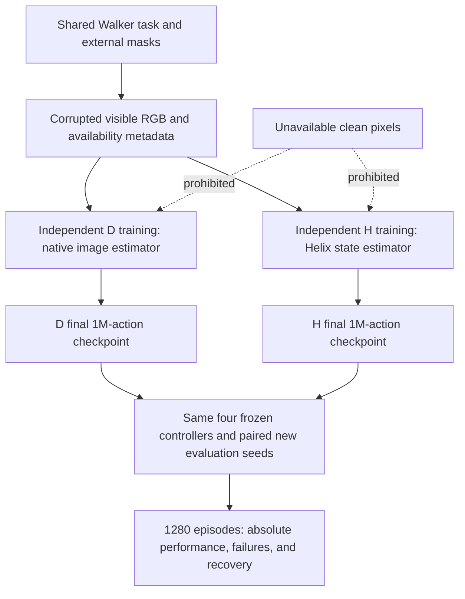

# DreamerV3 versus HelixWM: matched Walker camera-gap study

Machine-readable registration: [dreamerv3_helixwm_matched_20261026.json](../../configs/dreamerv3_helixwm_matched_20261026.json). This registration is a design artifact, not an executable training configuration or a passed launch gate.

**Status: DESIGN ONLY. No new training, evaluation, deployment, or GPU rental has been started by this protocol.** The user has selected two independent training runs, each with 1,000,000 action decisions, using the same missing-frame rules and visible training data. Code, configuration, capacity, and simulator gates must pass before launch.

## 1. Question and scope

Does HelixWM's state-estimation mechanism improve an independently trained agent's control during explicitly signalled camera gaps, compared with a native-image DreamerV3 agent trained under the same observation corruption?

The primary experiment is a matched **two-system comparison**. A checkpoint-by-controller evaluation then separates deployment effects from differences in the collected training trajectories. It is one paired training seed, not a multi-seed paper reproduction or a real-world safety test. Body dynamics remain unchanged. There is no automatic corruption detector, dynamics adaptation, or evaluation-time learning.

The completed 2026-10-18 continuity study is historical evidence. Its 1,560 episodes, especially the already inspected 1,040 held-out episodes, must not be reused as a new confirmation set. Its HelixWM checkpoint is not the DreamerV3 baseline for this experiment.

See the companion [DreamerV3 fidelity audit](2026-10-26-dreamerv3-fidelity.md) for the source and formula boundary. All new performance outcomes are **unknown**.

## 2. What “original DreamerV3” means here

Pin the official repository `https://github.com/danijar/dreamerv3` at `e3f02248693a79dc8b0ebd62c93683888ddaccfe`. Preserve its RSSM, encoder/decoder, world-model losses and loss weights, KL balancing/free-nats behavior, actor distribution and objective, critic/return calculations, normalizers, target networks, and optimizer implementations. The implementation must call these original components, not a rewritten approximation to their formulas.

Use official `defaults + dmc_vision + size12m` for **both** arms, with the shared task, interaction-budget, replay-capacity, precision, and orchestration settings below. The pinned repository's unmodified default RSSM dimensions correspond to its approximately 200M preset; `dmc_vision` does not automatically select `size12m`. This experiment therefore uses **the official core and an explicitly declared 12M size preset**, not the default 200M configuration. The exact parameter count must be measured. The pinned implementation must not be presented as a verified byte-for-byte reproduction of an unspecified original paper release.

The two implementations share the native replay-context path (`replay_context=1`). With `consec_train=1`, the sampler supplies 65 positions per batch sequence: one context position plus 64 learning positions. The native context application removes that first position before the loss, so batch size 16 gives 1,024 learning positions per update. Preserve `stepid`, `consec`, carry fields, and the native replay-update writeback. They must not reuse the old adapter's `replay_context=0` and custom 32-position burn-in while labelling that path native replay. Source review and an executable interface gate must establish that the native carry, incoming/outgoing action alignment, and replay state fields remain correct.

One shared orchestration adaptation is explicit: **copy policy parameters at each 500-action episode boundary and hold that inference version fixed during the episode**. Both arms use the same rule while the learner continues updating. This keeps all Helix candidates in a missing segment on one model version. It is not the unmodified author's policy-synchronization schedule, and the paper/report must disclose its possible effect. Native per-update synchronization must not be claimed unless a separately validated, version-consistent repair implementation replaces this rule.

## 3. Two independent training arms

### Mandatory identical-environment contract

The user's explicit requirement is that both training environments be identical. Both arms must import the **same single environment factory and fault wrapper**, from the same frozen source release, through the same Python interpreter and dependency build on the same RTX5090. There must not be one author DMC wrapper for D and an independently implemented Walker wrapper for H.

Before either arm starts, freeze one `environment_lock.json` and SHA256 binding the environment source files, dependency/build versions (Python, dm-control, MuJoCo, rendering libraries), native task and assets, GPU/driver/EGL rendering settings, camera, RGB shape/dtype and preprocessing, observation keys, action bounds/clipping/repeat, reward aggregation, terminal/time-limit discounts, episode horizon, and RNG/reset derivation. Both run manifests must reference the exact same lock hash, training reset-seed manifest and corruption-mask-bank hash. Availability metadata is available at the shared wrapper interface for both; the native estimator deliberately ignores it. No privileged state observation is enabled in either arm.

Training episode $i$ uses environment reset seed `100000 + i`, for $i=0,...,1999$, in both runs; training model seed remains 0. This seed range must pass the pre-launch seed-registry separation check. Fault masks are fixed by episode and observation index rather than wall time or reward. The same episode can therefore start in the same physical state and see the same exogenous fault timing even when later actions differ.

The equality gate runs the common environment in **two fresh processes**, including a reset and 500-action episode for each engineering seed 72000 and 72001, under the same stored six-dimensional fixed action trace. Repeat this for the clean wrapper and the registered fault wrapper. Require exact equality of reset images, supplied images, action arrays after clipping, availability, rewards, DMC call counts, discounts, terminal flags, and simulator-state diagnostic hashes. Save the trace, stepwise comparison, fingerprints and both process outputs. Diagnostic physics state is used only by this isolated gate and the evaluator, never by a training policy. Any mismatch blocks launch; do not quietly replace exact comparison with a tolerance or change one arm's environment. Revalidate after any runtime/source change and recheck the lock immediately before each arm starts.

This guarantees a checked identical transition/observation contract for the frozen runtime and fixed inputs; it does not promise identical trajectories under different learned actions or undetected future hardware failures. Actual training still records environment identity and faults so drift can be detected.

| Setting | D: native-image DreamerV3 | H: HelixWM V2 |
|---|---|---|
| Initialization | Independent run, training seed 0 | Independent run, same paired training seed 0 |
| Core model, loss, optimizer | Pinned official implementation | Same pinned official implementation |
| Observation delivered at a missing time | All-zero uint8 RGB | Same all-zero RGB, accompanied by the same availability metadata |
| Online estimator | Native posterior update treats the supplied image as an image; does not consume the availability flag | Uses the availability flag to skip missing-image encoding, propagate candidates, and reconnect on return |
| Learner images | Only the corrupted, visible RGB stream | Exactly the same visibility rule; no hidden clean targets |
| Training budget | 1,000,000 action decisions | 1,000,000 action decisions |

The exogenous mask and information available at the wrapper interface match. The native-image estimator ignores the metadata because the original policy has no missing-observation interface. Consequently, D versus H includes **the benefit of using availability metadata**, not only the benefit of multiple candidates. The `prior_only` control below is required to distinguish these explanations.

Learner inputs and reconstruction targets must use the stored corrupted RGB. Do not secretly save the clean image into the learner replay, omit masked positions from only one arm's loss, or feed synthetic candidate images to either learner. This intentionally differs from the old HelixWM run, whose collector was masked but whose learner replay retained clean frames. The old checkpoint therefore cannot substitute for H.

Different controllers will take different actions and collect different trajectories. “Same data” means the same information and visibility rules, task, and exogenous corruption process; it does not mean identical replay transitions. Exact shared replay would be a different offline experiment.

### Shared configuration

- Walker Walk; pixel-only RGB 64 by 64; camera 0; six bounded actions; action repeat 2.
- Each episode contains exactly 500 action decisions and 1,000 DMC `step` calls. Time limits and terminal discounts retain the same semantics in both arms.
- Each arm executes 2,000 training episodes: 1,000,000 decisions and 2,000,000 DMC calls. Together: **2,000,000 training decisions and 4,000,000 DMC calls**. Reset calls, evaluation, rendering, and MuJoCo integration substeps are not training decisions.
- Official `size12m`; batch size 16; training sequence length 64; `replay_context=1`; no added custom burn-in; replay capacity 1,000,000 transitions; replay ratio 256; 5,000-decision prefill; one environment per arm; shared BF16 compute setting on RTX5090.
- Prefill consumes the training budget and uses the same seeded bounded-random action rule in each run. This prefill rule is an explicitly shared harness choice, not a claim about the unmodified author's runner. The nominal subsequent update target is `floor(max(0, decisions - 5000) * 256 / (16 * 64))`, ending at 248,750 updates. The native scheduler integration must meet the registered counting contract before launch; no post-hoc extra updates to repair a count mismatch.
- Original actor sampling and the same action-bound handling apply to both arms. Do not evaluate one arm deterministically and the other stochastically.
- Save a complete checkpoint every 10,000 counted training decisions, and at the final budget. Fixed 500-action episodes make these exact episode boundaries. Preserve all checkpoint generations, optimizer/normalizer/target/RNG state, replay references and files, and the environment/collector boundary state.
- Every 20,000 training decisions, run five clean plus five fixed development-dropout episodes, separately counted. This is 500 development-evaluation episodes per arm, 250,000 decisions per arm, if all 50 scheduled rounds run. These scores cannot select a different final checkpoint or alter hyperparameters. Final acceptance uses the exactly 1,000,000-decision checkpoint.

### Training missingness

Generate all 2,000 episode masks before either run using a private mask RNG with registered seed `710000`. Store their exact bits and SHA256. A mask is indexed by observation timestamp, with $x_t$ available before action $a_t$. The initial $x_0$ and final $x_{500}$ are always valid.

For each eligible timestamp, start a burst with probability 0.02; sample its length uniformly from 1 through 5 actions. Accept a start only if the entire burst fits before the final observation. Force at least one valid observation after every burst before another start is possible. This makes **actual contiguous missing lengths** at most five, unlike the old generator whose adjacent nominal bursts could merge. Mask sampling is independent of policy, rewards, episode outcomes, and learner RNG. Both arms replay exactly the same per-episode masks, including during prefill. Log nominal and actual gap lengths.

## 4. Frozen checkpoint-by-controller evaluation

After both training runs finish and strict reload passes, evaluate **each new checkpoint** under the same four controllers. No old checkpoint enters the confirmatory comparison.

| Controller | Available image | Missing image | Interpretation |
|---|---|---|---|
| `clean_native` | Original posterior and actor | No gap | Checkpoint-specific reference |
| `black_frame_native` | Original posterior and actor | Encode zero pixels as a normal observation | Native-image baseline; no availability-aware inference |
| `prior_only` | Original posterior and actor | Skip encoder; advance one RSSM prior using the executed action | Availability-aware single-state adapter, not unmodified native inference |
| `helix_v2` | Original posterior and actor | Eight prior candidates, original V2 selection/reconnection | Helix module; unchanged actor and learner formulas |

Helix settings are fixed at eight candidates, a maximum repair segment of five missing observations, score normalization 12,288 and temperature 0.01. Beyond five missing observations, preserve V2's explicit abstention, discard the candidate set, and continue a single prior. This experiment must not imply that V2 has gained a 50-step repair mechanism.

In schematic notation, the native RSSM uses $h_t=f_\theta(h_{t-1},z_{t-1},a_{t-1})$, $p_\theta(z_t\mid h_t)$ and $q_\theta(z_t\mid h_t,x_t)$. Native black-frame inference supplies $\tilde{x}_t=0$ to the usual posterior. The single-prior adapter samples from $p_\theta(z_t\mid h_t)$ when availability $m_t=0$. Helix propagates candidates with the **executed** action; on a valid return it uses the preserved V2 decoder energy:

$$
w_t^{(i)}=\operatorname{softmax}_i\left(\log w_{t-1}^{(i)}+\frac{S_\theta(s_t^{(i)},x_t)}{12288\cdot 0.01}\right).
$$

$S_\theta$ is the existing negative pixel-error energy, not a calibrated likelihood. Do not multiply a transition prior into these weights a second time. Do not add a posterior assimilation to V2's selected candidate on the same return frame unless it is a separately named, registered intervention. The two previously tested V3 variants are not part of this main experiment.

### Fixed evaluation matrix and seeds

- Proposed new final environment seeds: **60000 through 60039**. Before launch, verify them against all prior evaluation manifests; a collision requires a revised registration before results are seen.
- Engineering smoke seeds: 72000 and 72001, disjoint from development and final evaluation. Training model seed, environment seed, actor RNG, latent RNG, candidate RNG, replay RNG, and mask RNG are named separately.
- Development evaluation seeds: 50000 through 50004, likewise subject to collision checking. They are not confirmation seeds.
- Each gapped episode has one gap beginning at observation timestamp 150, with length 1, 5, 10, 20, or 50. No gap touches reset or the terminal observation.
- Per checkpoint and environment seed: one clean episode plus three controllers times five lengths = 16 episodes.
- Per checkpoint: **640 final episodes**; both checkpoints: **1,280 final episodes**, **640,000 evaluation decisions**, **1,280,000 DMC calls**. These are additional to training and development evaluations. Engineering smoke also has a separate actual-interaction ledger.
- Planned training plus all development and final evaluations totals **3,140,000 action decisions and 6,280,000 DMC calls**, before engineering smoke or any explicitly reported failed attempts. Only 2,000,000 of those decisions are training.
- Use the same exogenous seeds and masks across paired conditions. A different action changes the subsequent physical trajectory; paired seeds do not mean identical hidden-state trajectories.
- All controllers on the same checkpoint must match the native clean path under a no-gap parity test. Preserve official latent/actor sampling semantics with private RNGs; do not label a root `SeedSequence` seed as the actor's directly seeded generator.
- No unavailable clean image, current physics state, future frame, or future reward may reach the policy, encoder, scoring function, or training data loader. Evaluator-only diagnostics must be segregated and access-tested.

## 5. Endpoints and interpretation

Let $r_t$ be the reward sum and $c_t$ the number of DMC calls for decision $t$. Use $u_t=r_t/c_t$, so a repeated action does not double the reward scale. For gap length $L$, use the window $W_L=[150,150+L+100)$.

The primary score is absolute normalized reward in the fault-plus-recovery window:

$$
A_{j,s,L,m}=\frac{1}{|W_L|}\sum_{t\in W_L}u^m_{j,s,L,t}.
$$

Higher is better. Equal-weight the five gap lengths within each seed. This absolute primary endpoint prevents a weak model from winning just because it loses little relative to a weak clean reference. Also report the checkpoint-specific deficit as a diagnostic:

$$
D_{j,s,L,m}=\frac{1}{|W_L|}\sum_{t\in W_L}\left(u^{\mathrm{clean}}_{j,s,t}-u^{m}_{j,s,L,t}\right).
$$

Here $j$ identifies the trained checkpoint, $s$ the environment seed, and $m$ the controller. Lower deficit is better, but a deficit improvement alone cannot establish the primary claim. Publish clean performance, absolute fault-window reward, absolute recovery-window reward, and full-episode return for every condition.

The primary whole-system contrast is H/`helix_v2` versus D/`black_frame_native`. Its interpretation is a total system difference, including learned trajectory distribution and use of availability metadata. A required stronger comparison is H/`helix_v2` versus D/`prior_only`. Test the paired absolute-score difference H minus comparator in the positive direction; use two predeclared primary tests with Holm correction. A registered overall superiority claim requires **both** comparisons to have a paired seed-cluster 95% confidence interval lower bound above zero and Holm-adjusted $p<0.05$.

Two further guards must pass: the observed aggregate functional-failure count must not increase against either comparator; and H's mean clean full-episode return must be at least 95% of D's mean clean return. The 5% clean-performance margin is an engineering choice fixed here, not a threshold supplied by the Dreamer paper. A nonpositive D clean mean makes the ratio guard inconclusive. The failure-count guard is descriptive, not a statistical safety/noninferiority guarantee. Record every violated or inconclusive guard; do not change the endpoint, margin, comparison, or seed subset after seeing results.

The crossed cells additionally report `helix_v2` versus `prior_only` **within each fixed checkpoint**, and D versus H under the same controller. These are secondary attribution analyses with their own labelled uncertainty; do not promote a favorable secondary slice to the primary result after seeing data.

- Cluster resampling preserves all arms and lengths within one environment seed; 10,000 paired bootstrap replicates. A paired sign-randomization test uses 100,000 draws and states its within-pair-exchangeability assumption. There is only **one training seed per arm**; the 40 evaluation environment seeds are not 40 independently trained models. Neither analysis measures variability across retraining seeds.
- Functional failure: $u_t<0.2$ for 20 consecutive actions within the gap-plus-100-action window. This is a performance proxy, not a certified fall or physical-safety detector.
- Recovery eligibility: the 50-action pre-gap mean is at least 0.75. After the return, a 10-action trailing mean must reach 90% of that episode's own pre-gap mean for 10 consecutive checks. Censor at 100 post-return actions. Keep failures and ineligible cases visible; never calculate a success percentage only from recovered cases.
- Report time to recovery together with fault-period failure counts. “Recovered within the window” does not mean uninterrupted normal control or reliable indefinite operation.
- Unexpected termination, exceptions, nonfinite data, and hash failures are technical failures. Preserve the attempted case, actual executed interactions, raw trace, and error; do not silently rerun or drop it. For the registered reward endpoint, retain the finite observed prefix and fill the unobserved remainder of the scheduled horizon with zero normalized reward, the lower bound of this task's reward range. Publish complete-case sensitivity separately. Unknown functional/posture failures remain unknown rather than being labelled successful or imputed from that reward tail; an unresolved technical or hash failure blocks a positive acceptance claim.
- Publish per-seed and per-duration failure counts and exact one-sided cluster-level binomial uncertainty. Forty zero-event clusters still have a 95% upper bound of approximately 7.22%; no 5% risk certification, noninferiority, or safety claim follows.

## 6. Implementation and acceptance gates

1. Freeze the official commit, both experiment configurations, corruption masks, source commit, RNG derivation, final-seed registry, and analysis definition. Keep the completed third experiment immutable.
2. Prove environment fidelity on the actual runtime: identical simulator versions, seeds, reset images, camera, action scaling, reward aggregation, discount/time-limit handling, and step counts for a fixed action trace. Do not assume that the official wrapper and historical custom `WalkerEnv` are interchangeable.
3. Prove native-core fidelity and matched execution: untouched official learner files; resolved size/loss/optimizer/replay configuration; action alignment; strict native replay carry; equal scheduling; common episode-boundary policy version; no clean-frame access. Helix inference integration into native replay is currently an implementation gate, not an existing verified capability.
4. On the rented RTX5090, validate finite original loss/gradients, GPU dtype/compatibility, no-gap controller parity, short-return and long-fallback paths, memory and storage forecasts, checkpoint strict reload, and fresh-process episode-boundary recovery. Retain original-version compatibility where possible; document any unavoidable dependency change before launch.
5. Use distinct tmux sessions/run directories and run the two training arms sequentially, with only one GPU-active learner at a time. A six-hour check performs one inspection, backs up stable artifacts, and stops. It must not auto-restart, change seeds or parameters, or release the instance.
6. Save all artifacts to the E-drive experiment directory, preserving old experiments. Validate every stable checkpoint and referenced replay file with remote pre/post and local SHA256. Do not promise exact mid-episode continuation across simulator/runtime changes.
7. At completion verify exact budgets, exit 0, both final checkpoints, all 1,280 planned final cases, frozen model/optimizer/normalizer/counter and training-RNG hashes, and zero evaluation updates. Save CSV/JSONL, trace data, configs, command/source/dependency/GPU provenance, curves in PNG and PDF, and full raw failure evidence.
8. Preserve one predeclared formal MP4 per actual stage. For the final crossed evaluation stage, create **one three-panel comparison MP4** from the already scheduled D/`black_frame_native`, H/`helix_v2`, and D/`prior_only` cases at seed60000/gap20. Synchronize panels by action timestamp; label checkpoint, controller, availability, and fault window. The panels show different trajectories after actions diverge, not a shared physical trajectory. Decode the full video; do not select a better seed after viewing outcomes. Smoke video is separately labelled and excluded from the formal-video count.
9. Once writes stop, generate and verify the complete per-file SHA256 manifest and archive/extracted-data consistency. Preserve exact missing items in acceptance results. No successful launch or partial budget counts as completed research acceptance.

The historical 12M checkpoint is 135,933,472 bytes; 200 such checkpoints alone would require approximately 25.32 GiB, before replay, logs, videos, temporary writes, or safety reserve. A new native-format checkpoint may differ in size. Use real smoke output to project both full runs, all replay, final evaluation, and temporary peak space; require at least 2 GiB additional reserve. The reported 2026-10-26 server free-space sample of about 33.23 GiB is not a capacity pass and must be rechecked at launch. Preserve existing data; do not automatically clean or expand storage.

## 7. Known historical differences and reporting boundary

The old Helix checkpoint `8aba0d3c6a1e9116850f34d24caf2fcdc0c68232d849d5bebbb9ec6239c8816e` used 1M actions, a 12M core, `replay_context=0`, custom 32-position burn-in, episode-level policy snapshots, masked collection with clean learner replay, and 57,038 masked observation times. Its previous final evaluation is already inspected. Preserve it as a labelled historical reference only.

This new protocol changes data visibility and replay integration to make the two new arms comparable. A result cannot be described as a continuation of that checkpoint or attributed solely to a formula change. The formula-level contribution under test is the state-estimation/controller interface; the official learning objectives remain unchanged.

The scope selection is confirmed. Remaining pre-launch decisions are implementation facts to validate: exact official replay/policy interface compatibility, the shared synchronization adaptation, absence of seed collisions, actual parameter count, and measured capacity/runtime. There is no approval to silently replace the model, increase the 2M combined training budget, add training seeds, or begin a dynamics-shift study.
