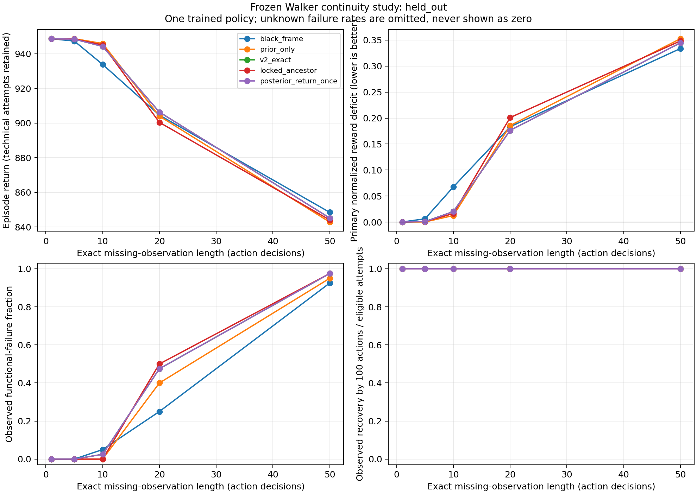

# Walker continuity under missing observations: completed frozen evaluation

**Result: `NOT_ESTABLISHED` for both proposed inference changes.** This publication contains the completed third HelixWM Walker experiment: **1,560 frozen evaluation episodes, one previously trained seed, six inference arms sharing the same model weights, and zero additional training updates**. It is not an independently trained DreamerV3 comparison or a new learning run.

The input model was trained for 1,000,000 action decisions in the earlier dual-chain experiment. This study evaluates what changes when the controller receives a known missing-frame interval. The model, optimizer, and training counters remain frozen. A full research account, equations, and limitations are in [REPORT.md](REPORT.md).

## Main result

The held-out split contains 40 environment seeds and 1,040 episodes. Neither `locked_ancestor` nor `posterior_return_once` demonstrated the predeclared improvement over both the original V2 controller and the single-prior control. All four primary confidence intervals include zero. Both proposals also have more observed functional-failure cases than `prior_only` (59 versus 54 out of 200 faulted episodes), failing that descriptive guard.

| Same-weight inference arm | Held-out episodes | Mean raw episode return | Functional-failure cases |
| --- | ---: | ---: | ---: |
| Clean observations | 40 | 948.6745 | 0/40 |
| Black frame | 200 | 916.5740 | 49/200 |
| Single prior | 200 | 918.0216 | 54/200 |
| Original V2 repair | 200 | 918.5696 | 59/200 |
| Locked ancestor | 200 | 917.3442 | 59/200 |
| Posterior return once | 200 | 918.5580 | 59/200 |

Faulted-arm means pool five equally represented gap lengths. The episodes within an environment seed are paired; these counts are not independent training seeds. Functional failure is a reward-window proxy, not a certified fall or safety event. These descriptive return means are not the primary test statistic.

## Original archived figures and one video



- [Held-out PDF](plots/held_out_robustness_recovery.pdf) and [design-split PNG](plots/design_robustness_recovery.png)/[PDF](plots/design_robustness_recovery.pdf) are byte-identical archived figures.
- [The sole formal video](videos/held_out_seed30000_v2_exact_gap20.mp4) is the preselected `v2_exact`, environment seed 30000, gap 20 episode: 501 frames at 20 fps. It is not a hand-picked successful demonstration. Its raw return is 859.9601; the renderer does not prove the agent received the visible raw frames during the gap. The saved mask and evaluator contract establish that distinction.
- [Historical input-model learning curve](reference_training/historical_learning_curve.png) ([PDF](reference_training/historical_learning_curve.pdf)) belongs to the earlier training run. This third experiment has robustness/recovery curves, not a new training learning curve.

## Inspect or recompute

Python 3.10 or later, standard library only:

```sh
python recompute.py
python recompute.py --output regenerated_tables
```

The first command verifies published file hashes, the complete case matrix, counters, per-duration arithmetic, seed-cluster means, and the four paired contrast means. The second writes basic CSV/JSON tables to a **new** directory. It does not run a simulator or rerun the archived bootstrap/randomization tests. See [DATA_DICTIONARY.md](DATA_DICTIONARY.md).

## Evidence and publication scope

- `data/{design,held_out}/*.csv`: eight byte-identical archived analysis tables, including all 1,560 case rows.
- `summary.public.json`: explicitly sanitized JSON derivatives; only the `plots` values were converted from private absolute paths to relative links. Every other JSON value is preserved.
- [publication_provenance.json](publication_provenance.json): original archive-relative paths and SHA-256 values, transformation labels, source/model identity, and omitted material.
- [publication_manifest.json](publication_manifest.json): hashes and sizes of the publication files; the manifest excludes itself.
- [data/acceptance.original.json](data/acceptance.original.json): unchanged archived acceptance record. Acceptance confirms the execution and preservation checks, not scientific superiority.

Checkpoints, replay, per-step image/state arrays, full source archives, private launcher configurations, credentials, and environment binaries are deliberately omitted. This compact public subset supports arithmetic review of the archived analysis; full raw-trace metric extraction and simulator reproduction require the separately retained complete experiment archive.
