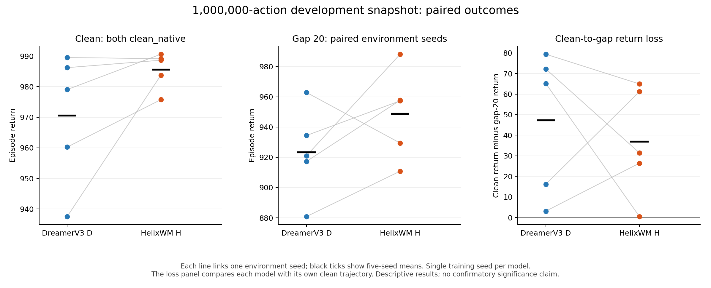
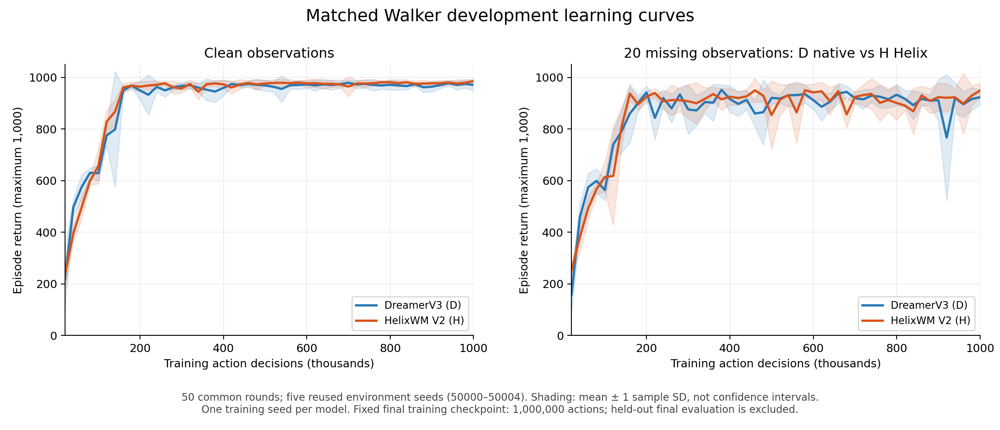
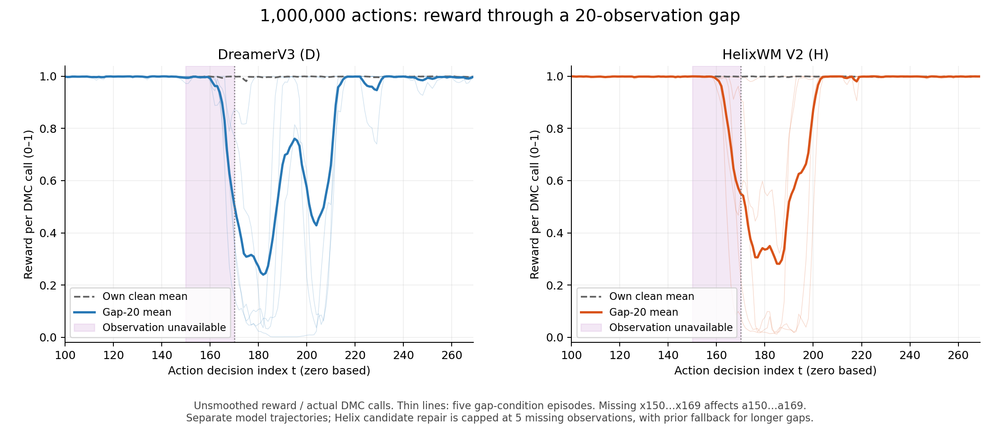

# Matched Walker: DreamerV3 vs HelixWM V2

**Development-evaluation report, 29 October 2026. Both trainings completed; confirmatory final evaluation and full acceptance remain pending.**

At the pre-specified 1M-action endpoint, H exceeds D by **15.07 raw episode-return points on clean observations** and **25.39 raw episode-return points in the gap20 condition**. H wins 4 of the 5 paired development seeds in each condition. However, the registered reward-based functional-failure definition flags **2/5 H cases versus 1/5 D cases** in the gap20 window. Mean return improves while this failure count worsens; the evidence does not support an across-the-board robustness or superiority claim.

## Endpoint results

| Condition at 1M actions | DreamerV3 D, mean ± sample SD | HelixWM H, mean ± sample SD | Paired mean H - D |
|---|---:|---:|---:|
| Clean native | 970.500 ± 21.637 | 985.567 ± 6.071 | +15.067 |
| Gap20: D black-frame native / H helix_v2 | 923.281 ± 29.703 | 948.670 ± 29.649 | +25.388 |

Raw episode return has a maximum of 1,000 (500 decisions, repeat 2). SD describes variation over five environment seeds, **not a confidence interval or variation over independent training runs**. The endpoint was fixed by the training budget, not selected for the highest result.

D loses 47.219 points from its own clean return; H loses 36.898. The loss is 10.321 points smaller for H. The ratios of mean gap20 return to mean clean return are 95.135% and 96.256% respectively. These ratios are not task-success rates.

## Complete development learning curves

All 50 scheduled checkpoints from 20k through 1M actions are included. Each checkpoint has clean plus its trained controller at gap20, each on seeds 50000–50004. Thus the published compact table contains **1,000 evaluation episodes**: 500 per arm. The same five development seeds recur across checkpoints; 50 checkpoints are not 50 independent training seeds. These episodes are separate from the 1,280 planned held-out final cases.

The trace unit is `reward[t] / dmc_calls[t]`; the black-frame mask removes observations 150–169. Plotting uses `availability_before_action` for action alignment, not the next observation's availability. Consult [data](data/) and the recomputation script for the exact displayed aggregation.

## What was matched

- Both independently trained seed-0 systems use the official DreamerV3 core at the author **size12m** preset, the same RGB64 Walker Walk camera/action wrapper, repeat 2, reset seeds, fault masks and budgets.
- Each completed exactly 1,000,000 actual actions, 2,000,000 DMC calls, 2,000 training episodes and 248,750 learner updates, with training exit code 0. Evaluation is excluded from training budgets.
- Both replay buffers contain only visible corrupted images; neither learner receives hidden clean-image targets. H uses the known availability signal and its V2 controller; D native processes black frames through ordinary observation updating.
- Different learned actions produce different trajectories and replay distributions. Matching the environment and external schedules does not make the trajectories identical.
- This is a shared experimental harness around the original core, **not an unchanged original-paper-scale/default-large-model reproduction**.

## What this does and does not show

H has higher mean development return in the two reported endpoint conditions. Both continue stepping through the controlled observation loss. This does not prove preserved task performance for arbitrary-duration outages, unknown faults, or physical-world safety.

For the gap20 plus 100-action recovery window, a functional failure means normalized reward below 0.2 for 20 consecutive actions. D has 1/5 flagged cases and H has 2/5. This is not a physical-fall detector. Both have 5/5 eligible cases satisfying the registered recovery rule within 100 actions; eventual recovery does not erase a preceding failure. The absolute mean normalized reward in this window is 0.803534 for D and 0.843990 for H. These are descriptive single-gap diagnostics, not the pre-registered five-gap final primary endpoint.

V2 keeps candidate branches for at most five consecutive missing observations; it falls back to a single prior from the sixth. Therefore a gap20 result cannot be attributed to candidate repair throughout all 20 steps. Model/training differences, availability use, and inference control all differ in the system-level comparison. Causal attribution requires the registered cross-controller final matrix.

No superiority test is presented on these reused five development seeds. The planned final evaluation uses 40 held-out environment seeds 60000–60039, clean once plus three controllers across gaps 1/5/10/20/50: 640 cases per model, 1,280 total. Its two pre-registered paired comparisons use seed-cluster bootstrap, positive-direction sign randomization, Holm correction, clean-performance and functional-failure guards. Missing final cases are pending, not zero-valued failures. One training seed per arm remains a limitation even after final evaluation.

## Integrity and provenance

- Frozen evidence passed for all 100 development-evaluation rounds, including backbone, host RNG and interaction-ledger checks.
- All 1,000 case JSON/NPZ/JSONL records agree; raw rewards were recomputed, and all 500 cross-arm seed/condition/checkpoint masks agree.
- The closed source snapshot contains 2,314 files (20,022,994 bytes), fetched read-only at 2026-10-29 12:01:59 UTC. Remote-before, remote-after and local SHA-256 match. Full evidence and all 200 checkpoint/replay archives stay on E; this repository intentionally contains only a compact auditable subset.
- Runtime commit: `97e049941bd755fab68e85e8bb1171911fa6cac8`; official upstream: `e3f02248693a79dc8b0ebd62c93683888ddaccfe`.
- [Registered protocol](../../configs/dreamerv3_helixwm_matched_20261026.json), [runtime](../../helixwm_matched/), [fidelity boundaries](../../docs/experiments/2026-10-26-dreamerv3-fidelity.md).

This report is not `FINAL_PACKAGE` acceptance. Final case counts, strict reload/frozen evidence, independent final-checkpoint recovery probes, the one pre-specified three-panel video, complete stable archival, and ZIP verification are still required. No running training/evaluation code or hyperparameter was changed to produce this report.
